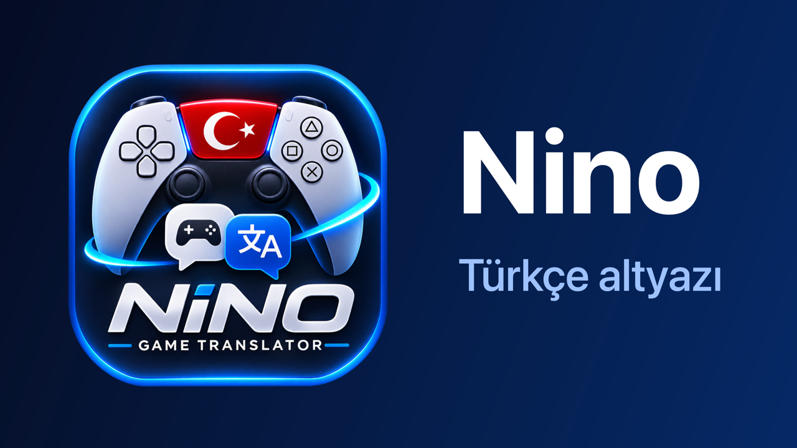
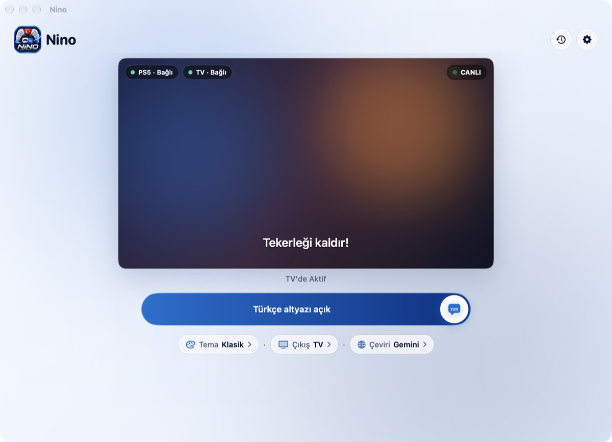

<p align="center"></p>

<h1 align="center">Nino Game Translator</h1>

<p align="center"><b>PS5 oyunlarını Türkçe oynayın.</b><br>
Oyundaki İngilizce altyazıyı anlık olarak Türkçeye çevirir ve TV'de, oyunun üstünde gösterir.<br>
Ücretsiz · açık kaynak · reklamsız · abonelik yok</p>

<p align="center">
  <a href="https://github.com/yunusdemirbag/nino-game-translator/releases/latest/download/Nino-Mac.zip"><b>⬇️ Mac</b></a> &nbsp;·&nbsp;
  <a href="https://github.com/yunusdemirbag/nino-game-translator/releases/latest/download/Nino-Windows-Setup.exe"><b>⬇️ Windows</b></a> &nbsp;·&nbsp;
  <a href="https://github.com/yunusdemirbag/nino-game-translator/releases/latest/download/Nino-Telefon.apk"><b>⬇️ Android telefon</b></a><br>
  <b>📺 TV için: Downloader'a ya da TV'nin tarayıcısına <code>is.gd/ninoapk</code> yazın</b>
</p>

---

## Nasıl çalışır

```
PS5 ──HDMI──▶ TV  ◀── Türkçe altyazı (TV'deki Nino uygulaması, oyunun üstünde)
 │                         ▲
 └─ Remote Play ──▶ Mac'teki Nino: görüntüyü okur → Türkçeye çevirir ─┘
    (ikinci, ücretsiz PSN hesabıyla)
```

Oyunu her zamanki gibi TV'de, kendi kolunuzla oynarsınız. Mac'teki Nino aynı görüntüyü Remote Play ile izler,
altyazıyı okur, çevirir ve TV'ye gönderir. TV'deki Nino çeviriyi İngilizcenin tam üstüne, tam opak bir kutuyla koyar.

<p align="center"></p>

## Neler yapar

- **Anlık Türkçe altyazı:** Konuşmalar, oyunun altyazısının üstüne aynı boyda ve aynı yerde yazılır.
- **Oyuna göre ayarlanır:** Her oyunun altyazısının ekranda nerede durduğunu kendisi öğrenir; alttaki görev ve öğretici yazılarını altyazıyla karıştırmaz.
- **Görev ve ipuçları da Türkçe:** Ekranın altındaki görev satırları ("Kampa dön") ve sol üstteki ipucu kutuları çevrilir.
- **Kumanda simgeleri yerinde:** "Hold ✕ to…" gibi satırlarda ✕ ○ △ □, L1–R3, yön tuşları tanınır ve Türkçe çeviride aynı yerde gösterilir.
- **Oyun paketleri:** Red Dead Redemption 2 gibi oyunların hazır Türkçe çevirileri anında gelir.
- **Türkçe dublaj (deneysel):** Çeviriyi Türkçe seslendirir. Oyunun kendi sesinden kimin konuştuğunu ve nasıl konuştuğunu (bağırma, fısıltı, soru) anlar; her karaktere kendi sesini verir.
- **Altyazı temaları:** Klasik, Sinema, Cam ve daha fazlası; ayarlar ekranında canlı önizleme.
- **Kendi kendini günceller:** Yeni sürüm çıkınca Mac uygulaması ana ekranda haber verir.

## Gerekenler

| | |
|---|---|
| **Konsol** | PS5 (Remote Play açık) |
| **PSN** | İkinci, ücretsiz bir PSN hesabı (Remote Play için; oyun sizin hesabınızda oynanır) |
| **Bilgisayar ya da telefon** | Apple Silicon (M1 ve sonrası) Mac, macOS 13 veya üzeri (en çok denenen) · Windows 10/11 (64 bit) · Android 8 ve üzeri telefon |
| **TV** | Android TV / Google TV (test edildi). LG webOS ve Samsung Tizen: deneysel, henüz gerçek TV'de denenmedi |
| **Çeviri** | Ücretsiz çeviri bilgisayarda, internetsiz çalışır. Daha iyi çeviri için ücretsiz bir **Gemini** anahtarı önerilir |

## Kurulum

### Mac
1. [Son sürümden](https://github.com/yunusdemirbag/nino-game-translator/releases/latest) `Nino-Mac.zip` dosyasını indirin, açın ve **Nino**'yu **Uygulamalar** klasörüne sürükleyin.
2. İlk açılışta Mac "doğrulanamadı" diyebilir: **Sistem Ayarları › Gizlilik ve Güvenlik › Yine de Aç**.
3. Nino adım adım yol gösterir: ikinci PSN hesabıyla giriş, PS5'i 8 haneli kodla eşleme, TV'yi seçme, deneme altyazısı.

### Windows
1. [Son sürümden](https://github.com/yunusdemirbag/nino-game-translator/releases/latest) `Nino-Windows-Setup.exe` dosyasını indirip çalıştırın. Yönetici izni istemez; kurulunca kendini günceller.
2. Windows "bilgisayarınızı korudu" derse **Ek bilgi › Yine de çalıştır**'a basın (uygulama imzasız olduğu için).
3. Nino adım adım yol gösterir (PSN girişi, PS5 eşleme, TV).

> Windows sürümü CouchSubs'ın Windows uygulamasından geliyor. Nino'nun Mac'teki yenilikleri (kumanda simgeleri, oyuna göre altyazı yeri, konuşanı tanıyan dublaj) henüz Windows'ta yok.

### Android telefon (bilgisayar yerine)
1. Telefonda [`Nino-Telefon.apk`](https://github.com/yunusdemirbag/nino-game-translator/releases/latest/download/Nino-Telefon.apk) dosyasını indirin ve açın.
2. Telefon izin isterse **Bu kaynaktan yüklemeye izin ver**'i açıp kurun.
3. Telefon PS5'e Remote Play ile bağlanır, altyazıyı okur ve TV'ye gönderir. Telefon şarja takılı ve aynı Wi-Fi'de kalmalı.

### TV (Android TV / Google TV)
- **En kolayı:** TV'de USB hata ayıklama açıksa Mac'teki Nino TV uygulamasını kendisi kurar ve günceller.
- **Elle:**
  1. TV'de Google Play'den ücretsiz **Downloader** uygulamasını kurun.
  2. Downloader'a **Bilinmeyen kaynaklardan yükleme** izni verin.
  3. Downloader'da (ya da TV'de tarayıcı varsa onun adres çubuğunda) **`is.gd/ninoapk`** yazıp **Git**'e basın, inen dosyayı kurun. Bu adres her zaman en yeni sürümü indirir.
  4. Bazı TV'lerde (TCL gibi) **Ayarlar › Uygulamalar › Özel uygulama erişimi › Diğer uygulamaların üzerinde göster › Nino** iznini açın.

TV'de Nino'yu açınca TV, PS5'in bağlı olduğu HDMI girişine geçer ve Nino görünmez bir katman olarak altyazıyı oyunun üstüne yazar. Kumandadaki **OK** tuşu bilgi panelini açar.

## Gizlilik

- Altyazı okuma (yazı tanıma) tamamen bilgisayarınızda yapılır.
- Ücretsiz çeviri bilgisayarınızda, internetsiz çalışır.
- Gemini gibi bir çeviri hizmeti seçerseniz yalnızca oyunun altyazı metni, **sizin anahtarınızla** o hizmete gider.
- Nino hesap açtırmaz, reklam göstermez, sizi izlemez.

## Sık sorulanlar

**Neden ikinci bir PSN hesabı gerekiyor?** Remote Play, PS5'e bağlanmak için bir hesap ister. Kendi hesabınızla oyun oynarken aynı anda o hesapla Remote Play açılamaz; ikinci (ücretsiz) hesap bunu çözer.

**Altyazı İngilizcenin tam üstüne gelmiyor.** Nino ilk birkaç altyazıda oyunun altyazı yerini öğrenir. Sorun sürerse Ayarlar › Altyazı'dan yerleşimi değiştirin.

**Dublajda yanlış ses çıkıyor.** Oyunun ses ayarlarında konuşma sesini kısın ama tamamen kapatmayın; Nino kimin konuştuğunu o sesten anlar.

## Kaynak koddan derleme

Mac uygulaması Swift/SwiftUI ile yazılmıştır; Remote Play bağlantısı için [chiaki-ng](https://github.com/streetpea/chiaki-ng)'nin kütüphanesi kullanılır.

```bash
git submodule update --init --recursive
./scripts/build-chiaki-macos.sh        # libchiaki (Remote Play)
cd mac && xcodegen generate && xcodebuild -scheme CouchSubs -configuration Release build
```

TV uygulaması: `tv-android` (Android TV), `tv-webos` (LG ve paylaşılan TV sayfası), `tv-tizen` (Samsung).
Windows uygulaması: `windows` (.NET/WPF). Android telefon uygulaması: `couchsubs-android`. Ayrıntılar CouchSubs'ın [orijinal README'sinde](docs/README-CouchSubs.md).

## Lisans ve teşekkür

Nino, **GNU AGPL-3.0** lisansıyla yayımlanan ücretsiz ve açık kaynak bir yazılımdır. Ayrıntılar: [LICENSE](LICENSE), [NOTICE](NOTICE).

**Nino © 2026 Yunus Demirbağ.** Based on [CouchSubs](https://github.com/yorulmazsinan/couchsubs) by Sinan Yorulmaz, modified by Yunus Demirbağ on 2026-11-15.

Nino şu projelerin üzerine kuruludur:
1. **[Chiaki](https://git.sr.ht/~thestr4ng3r/chiaki)** — Florian Märkl ve katkıda bulunanlar: açık kaynak PlayStation Remote Play istemcisi.
2. **[chiaki-ng](https://github.com/streetpea/chiaki-ng)** — Street Pea ve katkıda bulunanlar: Chiaki'nin bakımı süren devamı.
3. **[CouchSubs](https://github.com/yorulmazsinan/couchsubs)** — Sinan Yorulmaz: Nino'nun kodunun başladığı altyazı okuma ve çeviri uygulaması.
4. **Dublaj sesleri:** Kyutai'nin [pocket-tts](https://github.com/kyutai-labs/pocket-tts)'i ve [Pocket TTS Turkish](https://huggingface.co/wite-tech/pocket-tts-turkish) (wite-tech, CC BY 4.0). Sesler yapaydır, gerçek kişilere ait değildir.

Geliştiren: **Yunus Demirbağ** · Destekleyenler: **M. Akif Demirbağ**

*Nino, Sony Interactive Entertainment ile bağlantılı değildir. PlayStation ve PS5, Sony Interactive Entertainment Inc.'in ticari markalarıdır.*

---

### English

**Nino** translates the English subtitles of PS5 games into Turkish in real time and shows them on your TV, right on top of the game. A Mac (or a Windows PC, or an Android phone) watches the game through Remote Play (with a second, free PSN account), reads the subtitles, translates them and sends them to the Nino app on the TV. Free, open source (AGPL-3.0), no ads, no subscriptions. Based on CouchSubs by Sinan Yorulmaz.
