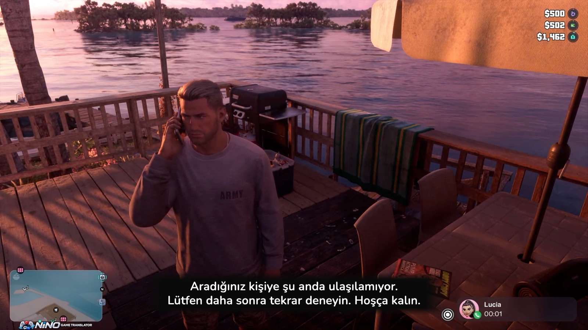
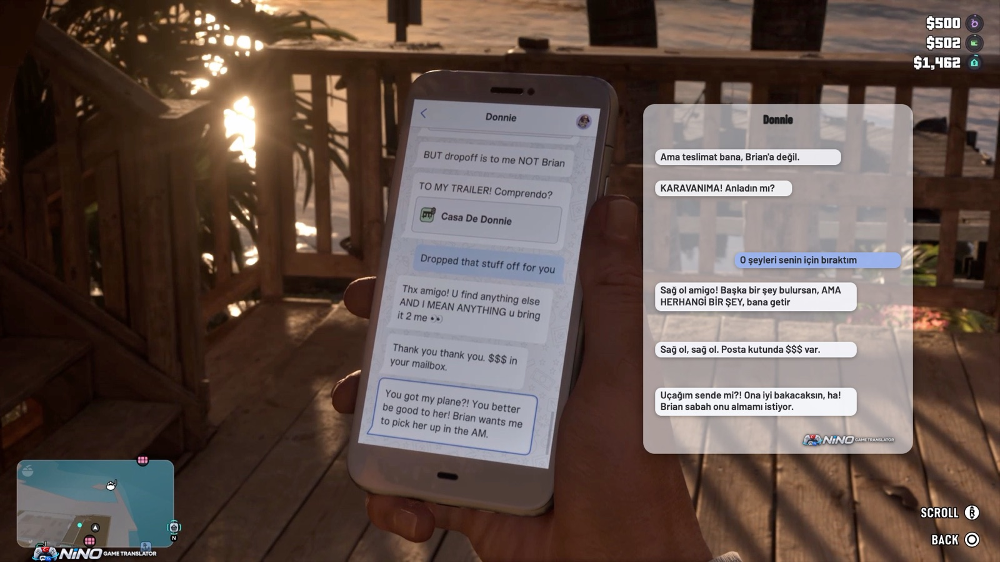
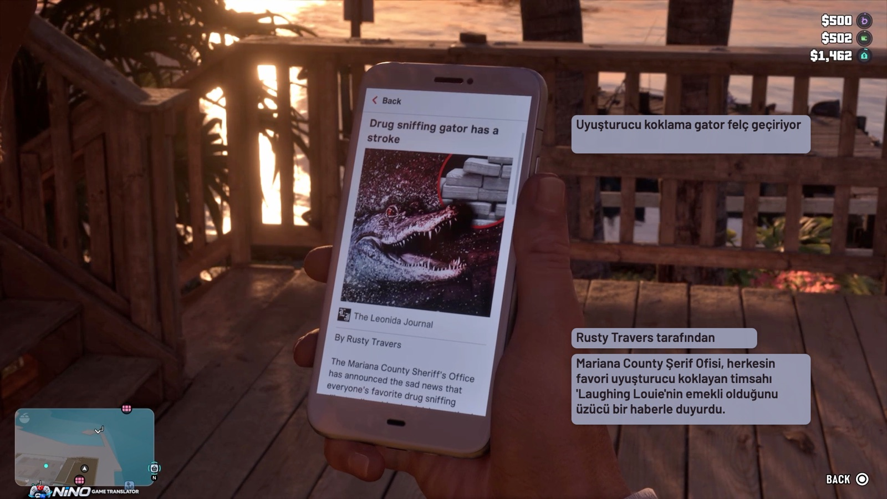
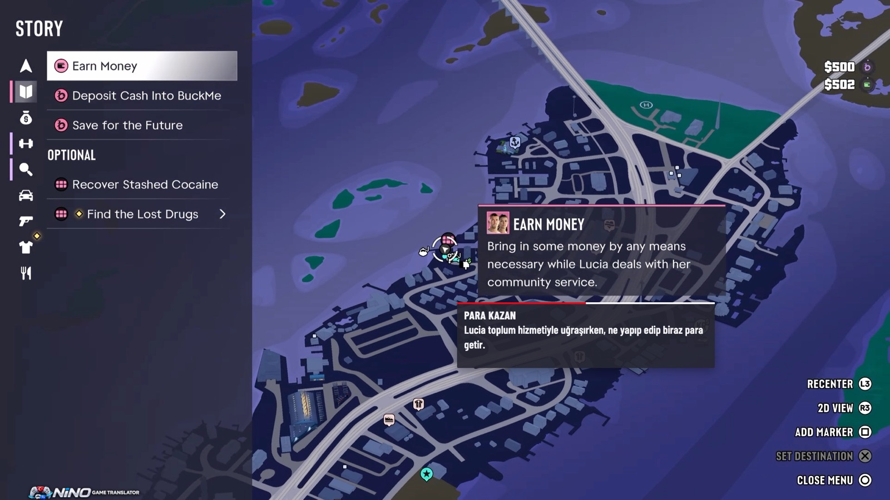
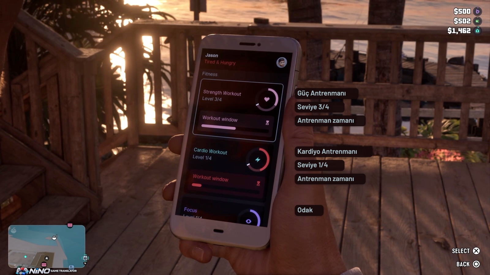

<p align="center"></p>

<h1 align="center">Nino Game Translator</h1>

<p align="center"><b>Türkçe desteği olmayan PS5 ve Xbox oyunlarını Türkçe oynayın.</b><br>
Nino oyundaki İngilizce yazıyı anında Türkçeye çevirir ve TV'de, oyunun tam üstünde gösterir.<br>
Ücretsiz · açık kaynak · reklam yok · abonelik yok · hesap yok<br>
Güncel sürüm: <b>Nino V4.0</b></p>

---

## ⬇️ İndir

Nino'yu **bir** cihaza kurmanız yeter: Mac, Windows ya da telefon. TV uygulamasını o cihazdaki Nino TV'ye kendisi kurar.

| Cihazınız | İndirme bağlantısı | Not |
|---|---|---|
| 🍎 **Mac** (M1 ve sonrası) | **[Nino-Mac.zip](https://github.com/yunusdemirbag/nino-game-translator/releases/latest/download/Nino-Mac.zip)** | En çok denenen, önerilen |
| 🪟 **Windows 10 / 11** | **[Nino-Windows-Setup.exe](https://github.com/yunusdemirbag/nino-game-translator/releases/latest/download/Nino-Windows-Setup.exe)** | Önerilen |
| 🤖 **Android telefon** (Android 8+) | **[Nino-Telefon.apk](https://github.com/yunusdemirbag/nino-game-translator/releases/latest/download/Nino-Telefon.apk)** | Bilgisayarınız yoksa |
| 📱 **iPhone / iPad** | **[TestFlight ile kur](https://testflight.apple.com/join/1K3Q1KXp)** | Önce App Store'dan TestFlight'ı kurun |
| 📺 **Android TV / Google TV** | Nino kendisi kurar · elle: **[tv.apk](https://yunusdemirbag.github.io/nino-game-translator/tv.apk)** | TV tarayıcısında kısa adres: `is.gd/ninotvapk` |
| 📺 **Samsung · LG TV** | Nino kendisi kurar | [Kurulum Rehberi › TV](docs/KURULUM.md#5-tv-uygulamasını-kurma) |

Tüm dosyalar ve sürüm notları: **[Sürümler sayfası](https://github.com/yunusdemirbag/nino-game-translator/releases/latest)** · Adım adım anlatım: **[📘 Kurulum Rehberi](docs/KURULUM.md)** · Fotoğraflı anlatım: **[📷 PS5 + Android TV](docs/KURULUM-ANDROID-TV.md)**

Mac, Windows ve Android telefondaki Nino sonraki güncellemeleri kendisi yükler.

## 🚀 3 adımda başlayın

1. **Nino'yu indirip açın** (yukarıdaki tablodan). İlk açılışta konsolunuzu seçin: **PS5** ya da **Xbox**.
2. **Nino'nun söylediklerini yapın.** PS5 için ikinci, ücretsiz bir PSN hesabıyla giriş yapıp PS5'teki 8 haneli kodu yazarsınız. Sonra TV'nizi seçersiniz; Nino TV uygulamasını kurar.
3. **Oyunu açın ve fişi prize takın.** Türkçe altyazı TV'de, oyunun üstünde görünür.

Bir dahaki sefere yalnız 3. adım yeterlidir. Takılırsanız uygulamadaki **Nino'ya Sor** robotu adım adım yardım eder.

## 🎮 Nino neleri çevirir

<table>
<tr>
<td width="50%"><br><b>Telefon mesajları</b><br>Gelen ve giden mesajlar, gönderenin adıyla, telefonun yanında kendi balonlarında.</td>
<td width="50%"><br><b>Haberler ve uygulamalar</b><br>Telefondaki başlıklar ve yazılar, uygulamanın kendi renkleriyle.</td>
</tr>
<tr>
<td><br><b>Harita görevleri</b><br>Görev kartı kartın hemen altında Türkçe; İngilizcenin üstünü kapatmaz.</td>
<td><br><b>Telefon menüleri</b><br>Her yazının Türkçesi kendi satırının hizasında.</td>
</tr>
<tr>
<td><br><b>Banka uygulaması</b><br>Hesap adları ve hedefler; tutarlar olduğu gibi kalır.</td>
<td><br><b>Taksi çağırma</b><br>Düğmeler ve seçenekler Türkçe.</td>
</tr>
</table>

<p align="center">
  <br>
  <sub>Gerçek bir TV'den, Red Dead Redemption 2. <a href="docs/nino/video/rdr2-turkce-altyazi.mp4"><b>▶️ Sesli video (30 sn)</b></a></sub>
</p>

## ✨ V4.0'da yenilikler

- 📱 **Oyundaki telefon Türkçe (Mac):** Mesajlar gönderenin adıyla, sağda ve solda kendi balonlarında; haber, banka, taksi ve spor uygulamaları kendi renkleriyle. Karanlıkta, parlamada ve gün ışığında da okunur.
- 🗺️ **Harita görev kartları (Mac):** Kartın tamamı, ikinci paragrafıyla birlikte okunur. Türkçesi kartın altına sığdırılır, İngilizcenin üstüne binmez. Kenarı Türk bayrağı kırmızı-beyazı.
- 🧊 **Buzlu altyazı zemini:** Altyazının arkası oyunun kendi altyazısı gibi buzlu cam. Sahne aydınlıksa koyulaşır, karanlıksa açılır.
- 🧹 **Daha temiz çeviri:** "Turn left" gibi navigasyon tarifleri ve "△ DRINKS" gibi etkileşim ipuçları artık altyazı sanılmaz. Altyazının yeri öğrenilince yalnız o bölge okunur.
- 🔌 **Yeni açılış:** Fiş prize takılır, toplam indirme sayısı yukarı doğru sayar. Mac, Windows, Android ve iPhone'da aynı tasarım.
- 🍏 **iPhone:** iOS 26'dan eski sürümlerde ücretsiz Gemini anahtarının neden gerektiği uygulamada açıkça anlatılıyor.
- 📺 **TV'de yazı boyu:** Android telefonda boyu değiştirince TV'deki altyazı da değişiyor (LG'de görülen sorun). İsteyen "TV'de oyunun altyazı boyuna uydur"u açık bırakabilir.
- 🎯 **GTA 6:** Uygulama yeniden açıldığında GTA renkleri ve "GTA 6 etkin" yazısı hemen geri geliyor.

Önceki sürümlerin notları: [Sürümler sayfası](https://github.com/yunusdemirbag/nino-game-translator/releases).

**Sürümünüz güncel mi?** Uygulamada **Ayarlar › Hakkında**'da **V4.0** yazmalı. TV'de Nino'yu açıp kumandada **OK**'e basın; panelin en üstünde **V4.0** yazmıyorsa telefondaki ya da bilgisayardaki Nino'dan **TV'ye kur**'a yeniden basın.

## Nasıl çalışır

```
PS5 ──HDMI──▶ TV  ◀── Türkçe altyazı (TV'deki Nino, oyunun üstünde)
 │                         ▲
 └─ Remote Play ──▶ Nino (Mac, Windows ya da telefon): okur → çevirir ─┘
    (ikinci, ücretsiz PSN hesabıyla)
```

Oyunu her zamanki gibi TV'de, kendi kolunuzla oynarsınız. Nino aynı görüntüyü Remote Play ile alır, yazıyı okur, çevirir ve TV'ye gönderir.

- **Capture Card'ınız varsa:** Mac ya da Windows görüntüyü karttan alır; Remote Play ve ikinci hesap gerekmez.
- **Xbox'ta:** Android telefon Xbox'ın ev yayınını Microsoft hesabınızla okur; Mac ve Windows Xbox penceresini okur. İkinci hesap gerekmez. ([Xbox kurulumu](docs/KURULUM.md#6-xbox-ile-kullanım-yeni-deneysel))
- **Monitörde oynuyorsanız:** Altyazıyı bilgisayarın ya da telefonun kendi ekranında gösterin.

## Gerekenler

| | |
|---|---|
| **Konsol** | PS5 (Remote Play açık) ya da Xbox Series X\|S (Uzak özellikler açık, deneysel) |
| **Nino'yu çalıştıran cihaz** | Mac (M1 ve sonrası, macOS 13+) · Windows 10/11 (64 bit) · Android 8+ telefon · iPhone |
| **Hesap** | PS5: ikinci, ücretsiz bir PSN hesabı (oyun yine sizin hesabınızda oynanır). Xbox: kendi Microsoft hesabınız. |
| **Ağ** | Konsol, Nino'nun cihazı ve TV aynı Wi-Fi'da |

### Desteklenen TV'ler

| TV | Durum | Kurulum için |
|---|---|---|
| **Android TV / Google TV:** TCL, iFFALCON, Sony, Philips, Xiaomi, Hisense, Vestel, Arçelik, Beko, Grundig, Toshiba ve diğerleri | ✅ Denendi | USB hata ayıklamayı bir kez açın |
| **Samsung** TV ve Samsung akıllı monitör (M serisi, 2016 ve sonrası) | 🧪 Deneysel | Geliştirici modunu bir kez açın |
| **LG** (webOS) | 🧪 Deneysel | Geliştirici modunu bir kez açın |
| Akıllı olmayan TV ya da monitör | ✅ | Altyazı bilgisayarda ya da telefonda görünür |

Adımlar: [Kurulum Rehberi › TV](docs/KURULUM.md#5-tv-uygulamasını-kurma).

> **TCL ve iFFALCON TV'lerde:** Nino'yu elle (tv.apk ile) kurduysanız **Ayarlar › Uygulamalar › Özel uygulama erişimi › Diğer uygulamaların üzerinde göster**'den Nino'ya izin verin. Yoksa TV "PS5 görüntüsü Nino'nun içinde gelmiyor" der. Bilgisayardaki ya da telefondaki Nino ile kurulumda bu izni Nino kendisi verir.

## Sık sorulanlar

**Neden ikinci bir PSN hesabı gerekiyor?** Remote Play bağlanmak için bir hesap ister. Kendi hesabınızla oynarken aynı hesapla Remote Play açılamaz; ikinci, ücretsiz hesap bunu çözer.

**Ekranda "Uzaktan Oynama bağlandı" bildirimi çıkıyor.** PS5'te ikinci hesapla **Ayarlar › Sistem › Uzaktan Oynama**'da en alttaki **Uzaktan Oynama Bağlantı Durumunu Gizle**'yi açın.

**TV'de "Bilgisayardaki Nino bekleniyor" yazısı gitmiyor.** Nino'nun açık ve fişin takılı olduğundan emin olun. TV ve Nino'nun cihazı aynı Wi-Fi'da olmalı. Nino'nun yalnız **bir** kopyası açık olmalı.

**Altyazı İngilizcenin tam üstüne gelmiyor.** Nino ilk birkaç altyazıda oyunun altyazı yerini öğrenir. Sorun sürerse **Ayarlar › Altyazı**'dan yerleşimi değiştirin.

**iPhone'da GTA 6 dışındaki oyunlar çevrilmiyor.** Apple'ın ücretsiz, cihaz içi çevirisi iOS 26 ister. Daha eski iOS'ta GTA 6 Nino'nun çeviri havuzundan gelir; diğer oyunlar için uygulamadaki adımlarla ücretsiz bir Gemini anahtarı ekleyin.

**iPhone'da ekran kapanınca bağlantı kopuyor.** iOS arka plandaki uygulamayı durdurur. Çeviri sürerken telefonu kilitlemeyin, mümkünse şarja takın.

**PS5'im yok, önce görmek istiyorum.** Android telefonda ana ekrandaki **"PS5'siz Deneyin"**e dokunun.

**Takıldım, kime sorarım?** Uygulamada **Nino'ya Sor**'a yazın ya da Ayarlar'daki **Sorun Bildir**'den ekran görüntüsüyle bize ulaşın. Hata bildirimleri: [Issues](https://github.com/yunusdemirbag/nino-game-translator/issues).

Daha fazlası: [Kurulum Rehberi › Sık karşılaşılan durumlar](docs/KURULUM.md#9-sık-karşılaşılan-durumlar).

## Gizlilik

- Yazı tanıma ve ücretsiz çeviri cihazınızda yapılır.
- Kendi anahtarınızla Gemini, DeepL gibi bir hizmet seçerseniz yalnız altyazı metni o hizmete gider.
- **Ortak çeviri havuzu:** Pakette olmayan İngilizce satırlar (yalnız metin, adsız) Nino'nun sunucusunda yapay zekâ ile bir kez çevrilir ve herkes kullanır. Oyunu tanımak için arada bir küçük bir oyun karesi gönderilir; saklanmaz. Ayarlar'dan kapatabilirsiniz.
- Nino hesap açtırmaz, reklam göstermez, sizi izlemez. Ayrıntılar: [PRIVACY.md](PRIVACY.md).

## العربية · Arapça

<p dir="rtl" align="right"><b>نينو</b> يقرأ الترجمة الإنجليزية في ألعاب PS5 و Xbox ويعرضها مترجمة إلى العربية فورًا فوق اللعبة على التلفاز، عبر تطبيق Mac أو Windows أو الهاتف. اختر العلم السعودي لتختار الترجمة العربية. مجاني بالكامل، مفتوح المصدر، بلا إعلانات ولا اشتراكات.</p>

## Kaynak koddan derleme

Mac ve iPhone uygulamaları Swift/SwiftUI, Android uygulaması Kotlin/Jetpack Compose, Windows uygulaması .NET/WPF ile yazılmıştır. Remote Play için [chiaki-ng](https://github.com/streetpea/chiaki-ng) kullanılır.

```bash
git submodule update --init --recursive
./scripts/build-chiaki-macos.sh
cd mac && xcodegen generate && xcodebuild -scheme CouchSubs -configuration Release build
```

Klasörler: `mac`, `windows`, `couchsubs-android` (telefon), `couchsubs-ios`, `tv-android` (Android TV), `tv-webos` (LG ve ortak TV sayfası), `tv-tizen` (Samsung). Ayrıntılar: CouchSubs'ın [orijinal README'si](docs/README-CouchSubs.md).

## Lisans ve teşekkür

Nino, **GNU AGPL-3.0** lisanslı ücretsiz ve açık kaynak bir yazılımdır: [LICENSE](LICENSE), [NOTICE](NOTICE).

**Nino © 2026 Yunus Demirbağ.** Based on [CouchSubs](https://github.com/yorulmazsinan/couchsubs) by Sinan Yorulmaz, modified by Yunus Demirbağ on 2026-11-21.

Nino şu projelerin üzerine kuruludur:
1. **[Chiaki](https://git.sr.ht/~thestr4ng3r/chiaki)** — Florian Märkl ve katkıda bulunanlar: açık kaynak PlayStation Remote Play istemcisi.
2. **[chiaki-ng](https://github.com/streetpea/chiaki-ng)** — Street Pea ve katkıda bulunanlar: Chiaki'nin bakımı süren devamı.
3. **[CouchSubs](https://github.com/yorulmazsinan/couchsubs)** — Sinan Yorulmaz: Nino'nun kodunun başladığı altyazı okuma ve çeviri uygulaması.
4. **Dublaj sesleri:** Kyutai'nin [pocket-tts](https://github.com/kyutai-labs/pocket-tts)'i ve [Pocket TTS Turkish](https://huggingface.co/wite-tech/pocket-tts-turkish) (wite-tech, CC BY 4.0). Sesler yapaydır, gerçek kişilere ait değildir.
5. **Ücretsiz, internetsiz çeviri:** Windows'ta Helsinki Üniversitesi'nin [OPUS-MT](https://github.com/Helsinki-NLP/Opus-MT) modeli (CC BY 4.0); Mac ve iPhone'da Apple'ın, Android'de Google ML Kit'in cihaz içi çevirisi.
6. **Yazı tanıma:** Apple Vision (Mac, iPhone), Windows OCR ve Google ML Kit (Android).
7. **Bilgisayarda yapay zekâ ile çeviri (isteğe bağlı):** [Ollama](https://ollama.com), Google'ın [TranslateGemma](https://ollama.com/library/translategemma)'sı ve Xiaomi'nin [MiLMMT](https://huggingface.co/xiaomi-research/MiLMMT-46-4B-v1.0)'si.
8. **Çevrimiçi çeviri (isteğe bağlı, kendi anahtarınızla):** Google Gemini, DeepL, OpenAI, Claude.
9. **Xbox:** UnknownSKL'nin [Greenlight](https://github.com/unknownskl/greenlight)'ı ve [xal-node](https://github.com/unknownskl/xal-node)'u (MIT; akış onlardan öğrenildi, kod Kotlin'de yeniden yazıldı) ve Google'ın [WebRTC](https://webrtc.org)'si (BSD-3).
10. **Diğer açık kaynak parçalar:** FFmpeg, OpenSSL, curl, nanopb, Jerasure, GF-Complete, json-c, libevent, miniupnpc, ONNX Runtime, Velopack, SSH.NET ve Patrick Stel'in [tizen-sdb](https://github.com/PatrickSt1991/tizen-sdb)'si. Tam liste: [THIRD-PARTY-NOTICES.md](THIRD-PARTY-NOTICES.md).

Bu projelerin geliştiricilerine çok teşekkürler. 🙏

Geliştiren: **Yunus Demirbağ** · Destekleyenler: **M. Akif Demirbağ**

*Nino, Sony Interactive Entertainment ve Microsoft ile bağlantılı değildir. PlayStation ve PS5, Sony Interactive Entertainment Inc.'in; Xbox, Microsoft Corporation'ın ticari markalarıdır. Ekran görüntülerindeki oyun görüntüleri sahiplerine aittir.*

---

### English

**Nino** translates the English text of PS5 and Xbox games into Turkish (and 10 other languages) in real time and shows it on your TV, right on top of the game. A Mac, Windows PC, Android phone or iPhone watches the game through Remote Play (with a second, free PSN account), reads the subtitles, in-game phone messages, apps and map missions, translates them and sends them to the Nino app on the TV. On Xbox (experimental) the Android app signs in with your Microsoft account; Mac and Windows read the Xbox window. Free, open source (AGPL-3.0), no ads, no subscriptions. Based on CouchSubs by Sinan Yorulmaz. **Downloads:** see the table at the top.
