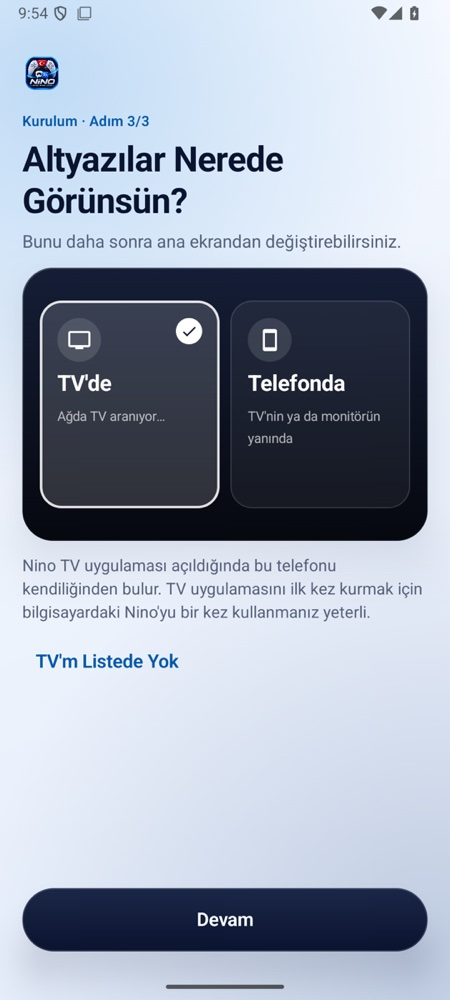
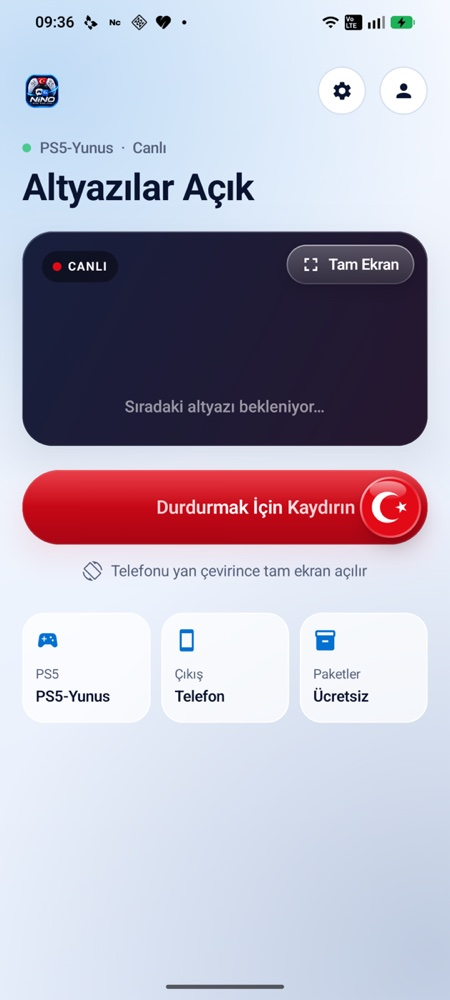
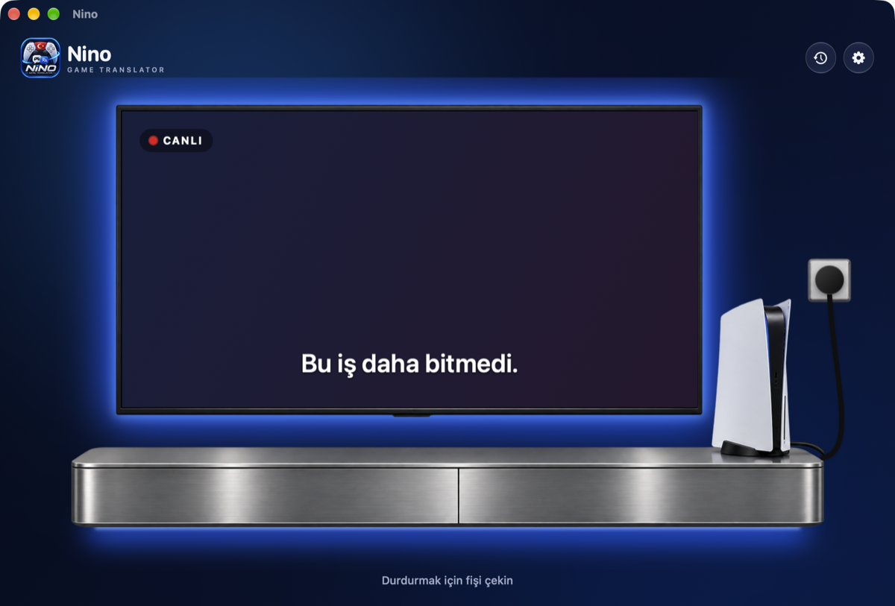
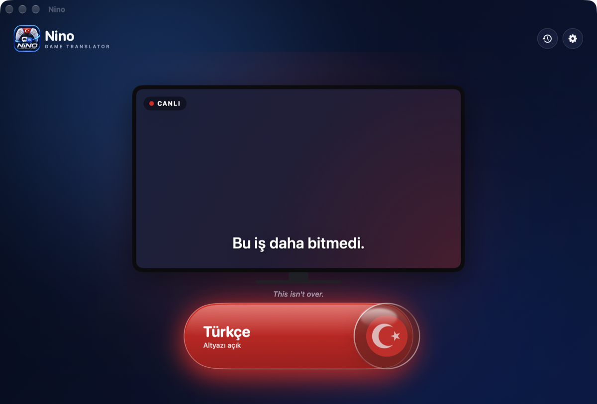

<p align="center"></p>

<h1 align="center">Nino Game Translator</h1>

<p align="center"><b>Türkçe desteği olmayan PS5 oyunlarını Türkçe oynayın.</b><br>
Oyundaki İngilizce altyazıyı anlık olarak Türkçeye (ya da Arapçaya) çevirir; TV'de oyunun üstünde ya da telefonunuzda gösterir.<br>
Tamamen ücretsiz · açık kaynak · reklamsız · abonelik yok · hesap yok</p>

<p align="center">
  <a href="https://github.com/yunusdemirbag/nino-game-translator/releases/latest/download/Nino-Telefon.apk"><b>⬇️ Android telefon</b></a> &nbsp;·&nbsp;
  <a href="https://github.com/yunusdemirbag/nino-game-translator/releases/latest/download/Nino-Mac.zip"><b>⬇️ Mac</b></a> &nbsp;·&nbsp;
  <a href="https://github.com/yunusdemirbag/nino-game-translator/releases/latest/download/Nino-Windows-Setup.exe"><b>⬇️ Windows</b></a> &nbsp;·&nbsp;
  <b>📱 iPhone: App Store incelemesinde</b><br>
  <b>📺 TV için: Downloader'a ya da TV'nin tarayıcısına <code>is.gd/ninoapk</code> yazın</b> &nbsp;·&nbsp;
  <a href="docs/KURULUM.md"><b>📘 Kurulum Rehberi</b></a>
</p>

<p align="center">
  &nbsp;
  &nbsp;
  &nbsp;
  
</p>

---

## 0.1.7'de yenilikler

- **Yeni telefon tasarımı (Android ve iPhone):** Sade, tek odaklı ana ekran. Durum satırı, büyük başlık, canlı altyazıların aktığı koyu sahne kartı ve **"Başlatmak İçin Kaydırın"** çubuğu. Kaydırınca çubuk bayrak rengine döner, tutamaç camlı bir **ay yıldız** (Arapça'da 🇸🇦) küresine dönüşür.
- **Yan çevirin, tam ekran açılsın:** Çeviri açıkken telefonu yan çevirince altyazı tam ekran açılır. Ana ekran hep dikey kalır.
- **Yenilenen kurulum ekranları:** Karşılama, PSN girişi, PS5 eşleme ve altyazı yeri seçimi aynı premium görünümde.
- **PS5'siz demo:** "PS5'siz Deneyin" ile örnek altyazılarla uygulamayı PS5 olmadan gezebilirsiniz.
- **Tam Arapça desteği:** Çeviri dili Arapça seçilince menüler de Arapçaya döner ve her şey sağdan sola dizilir. Uygulama yalnız Türkçe ve Arapça açılır.
- **PS5 kendiliğinden bulunur:** Eşleme ekranı PS5'i sürekli arar; PS5'i sonradan açsanız da IP yazmanıza gerek kalmaz.
- **Daha çok Android telefonda çalışır:** Bazı MediaTek işlemcili telefonlarda görüntünün okunamaması düzeltildi.
- **HDMI yakalama kartı (Mac ve Windows):** PS5 görüntüsünü yakalama kartından alma. Remote Play ve ikinci PSN hesabı gerekmez.
- **Sony giriş sayfası** Android'de artık boş gelmiyor; ücretsiz çeviri modeli inmezse kendiliğinden yeniden deneniyor.

## Nasıl çalışır

```
PS5 ──HDMI──▶ TV  ◀── Türkçe altyazı (TV'deki Nino uygulaması, oyunun üstünde)
 │                         ▲
 └─ Remote Play ──▶ Nino (telefon, Mac ya da Windows): okur → çevirir ─┘
    (ikinci, ücretsiz PSN hesabıyla)
```

Oyunu her zamanki gibi kendi kolunuzla oynarsınız. Telefondaki (ya da bilgisayardaki) Nino aynı görüntüyü Remote Play ile alır, altyazıyı okur, çevirir ve TV'ye gönderir ya da kendi ekranında gösterir. PS5'iniz sıradan bir monitöre bağlıysa telefonu ekranın yanına koymanız yeterli.

## Ekran görüntüleri

<p align="center">
  &nbsp;
  &nbsp;
  &nbsp;
  &nbsp;
  
</p>

<p align="center">
  &nbsp;
  
</p>

## العربية · Arapça

<p align="center">
  &nbsp;
  &nbsp;
  
</p>

<p dir="rtl" align="right"><b>نينو</b> يقرأ الترجمة الإنجليزية في ألعاب PS5 ويعرضها مترجمة إلى العربية فورًا، على التلفاز فوق اللعبة أو على هاتفك. اختر العلم السعودي في شاشة الترحيب لتتحول الواجهة بالكامل إلى العربية. مجاني بالكامل، مفتوح المصدر، بلا إعلانات ولا اشتراكات.</p>

## Kimler kullanabilir

| Nino'yu çalıştıran cihaz | Durum |
|---|---|
| **Android telefon** (Android 8 ve üzeri) | ✅ Hazır, yeni tasarım |
| **Mac** (Apple Silicon: M1 ve sonrası) | ✅ Hazır |
| **Windows 10/11** bilgisayar | ✅ Hazır |
| **iPhone** | 🔜 App Store incelemesinde |

| Altyazının çıktığı yer | Durum |
|---|---|
| **Android TV / Google TV** (TCL, Sony, Philips, Xiaomi, Hisense ve diğerleri) | ✅ Hazır, denendi |
| **Telefon ekranı** (TV uygulaması olmadan, monitörde oynayanlar için) | ✅ Hazır |
| **LG** (webOS) · **Samsung** (Tizen) | 🧪 Deneysel |

## Gerekenler

| | |
|---|---|
| **Konsol** | PS5 (Remote Play açık) |
| **PSN** | İkinci, ücretsiz bir PSN hesabı (Remote Play için; oyun sizin hesabınızda oynanır). Yakalama kartıyla gerekmez. |
| **Telefon ya da bilgisayar** | Android 8+ telefon · Apple Silicon Mac (macOS 13+) · Windows 10/11 (64 bit) |
| **Ağ** | PS5, telefon/bilgisayar ve TV aynı Wi-Fi'de |

## Kurulum

Adım adım, görselli anlatım: **[📘 Kurulum Rehberi](docs/KURULUM.md)**

**Kısaca (Android telefon):**
1. [`Nino-Telefon.apk`](https://github.com/yunusdemirbag/nino-game-translator/releases/latest/download/Nino-Telefon.apk)'yı telefonda indirip kurun ("Bu kaynaktan yüklemeye izin ver").
2. Nino'yu açın, ikinci PSN hesabınızla **Sony İle Giriş Yapın**.
3. PS5'te **Ayarlar › Sistem › Uzaktan Oynatma › Cihazı Eşle**'deki 8 haneli kodu yazın.
4. Altyazının nerede görüneceğini seçin (TV ya da telefon), oyunu açın ve **kaydırın**.

**Mac:** [`Nino-Mac.zip`](https://github.com/yunusdemirbag/nino-game-translator/releases/latest/download/Nino-Mac.zip)'i indirip Nino'yu Uygulamalar'a sürükleyin; Nino adım adım yol gösterir ve kendini günceller.
**Windows:** [`Nino-Windows-Setup.exe`](https://github.com/yunusdemirbag/nino-game-translator/releases/latest/download/Nino-Windows-Setup.exe)'yi çalıştırın.
**TV (Android TV / Google TV):** Downloader'a `is.gd/ninoapk` yazın ya da Mac'teki Nino'nun kurmasına izin verin.

## Gizlilik

- Altyazı okuma (yazı tanıma) ve ücretsiz çeviri cihazınızda yapılır.
- Gemini, DeepL gibi bir çeviri hizmeti seçerseniz yalnızca altyazı metni, **sizin anahtarınızla** o hizmete gider.
- **Ortak havuz:** Hazır pakette bulunmayan İngilizce altyazı satırları (yalnız metin, adsız) yeni oyun paketleri hazırlamak için Nino'nun kendi havuzuna gönderilir. Ayarlar'dan kapatabilirsiniz; kapatınca bekleyen satırlar da silinir.
- Nino hesap açtırmaz, reklam göstermez, sizi izlemez. Ayrıntılar: [PRIVACY.md](PRIVACY.md).

## Sık sorulanlar

**PS5'im yok, önce görmek istiyorum.** Telefonda ana ekrandaki **"PS5'siz Deneyin"**e dokunun; örnek altyazılarla uygulamayı gezebilirsiniz.

**Neden ikinci bir PSN hesabı gerekiyor?** Remote Play, PS5'e bağlanmak için bir hesap ister. Kendi hesabınızla oyun oynarken aynı anda o hesapla Remote Play açılamaz; ikinci (ücretsiz) hesap bunu çözer.

**Ekranda sürekli "Uzaktan Oynama" bildirimi çıkıyor.** PS5'te **Ayarlar › Sistem › Uzaktan Oynama**'ya gidip en alttaki seçeneği kapatın.

**Altyazı İngilizcenin tam üstüne gelmiyor.** Nino ilk birkaç altyazıda oyunun altyazı yerini öğrenir. Sorun sürerse Ayarlar › Altyazı'dan yerleşimi değiştirin.

**Dublajda yanlış ses çıkıyor.** Oyunun ses ayarlarında konuşma sesini kısın ama tamamen kapatmayın; Nino kimin konuştuğunu o sesten anlar.

## Kaynak koddan derleme

Mac ve iPhone uygulamaları Swift/SwiftUI, Android uygulaması Kotlin/Jetpack Compose ile yazılmıştır; Remote Play bağlantısı için [chiaki-ng](https://github.com/streetpea/chiaki-ng)'nin kütüphanesi kullanılır.

```bash
git submodule update --init --recursive
./scripts/build-chiaki-macos.sh        # libchiaki (Remote Play)
cd mac && xcodegen generate && xcodebuild -scheme CouchSubs -configuration Release build
```

TV uygulaması: `tv-android` (Android TV), `tv-webos` (LG ve paylaşılan TV sayfası), `tv-tizen` (Samsung).
Windows uygulaması: `windows` (.NET/WPF). Android telefon uygulaması: `couchsubs-android`. Ayrıntılar CouchSubs'ın [orijinal README'sinde](docs/README-CouchSubs.md).

## Lisans ve teşekkür

Nino, **GNU AGPL-3.0** lisansıyla yayımlanan ücretsiz ve açık kaynak bir yazılımdır. Ayrıntılar: [LICENSE](LICENSE), [NOTICE](NOTICE).

**Nino © 2026 Yunus Demirbağ.** Based on [CouchSubs](https://github.com/yorulmazsinan/couchsubs) by Sinan Yorulmaz, modified by Yunus Demirbağ on 2026-11-16.

Nino şu projelerin üzerine kuruludur:
1. **[Chiaki](https://git.sr.ht/~thestr4ng3r/chiaki)** — Florian Märkl ve katkıda bulunanlar: açık kaynak PlayStation Remote Play istemcisi.
2. **[chiaki-ng](https://github.com/streetpea/chiaki-ng)** — Street Pea ve katkıda bulunanlar: Chiaki'nin bakımı süren devamı.
3. **[CouchSubs](https://github.com/yorulmazsinan/couchsubs)** — Sinan Yorulmaz: Nino'nun kodunun başladığı altyazı okuma ve çeviri uygulaması.
4. **Dublaj sesleri:** Kyutai'nin [pocket-tts](https://github.com/kyutai-labs/pocket-tts)'i ve [Pocket TTS Turkish](https://huggingface.co/wite-tech/pocket-tts-turkish) (wite-tech, CC BY 4.0). Sesler yapaydır, gerçek kişilere ait değildir.
5. **Ücretsiz, internetsiz çeviri:** Windows'ta Helsinki Üniversitesi'nin [OPUS-MT](https://github.com/Helsinki-NLP/Opus-MT) İngilizce→Türkçe modeli (CC BY 4.0); Mac ve iPhone'da Apple'ın, Android'de Google ML Kit'in cihaz içi çevirisi.
6. **Yazı tanıma:** Apple Vision (Mac, iPhone), Windows OCR ve Google ML Kit (Android).
7. **Bilgisayarda yapay zekâ ile çeviri (isteğe bağlı):** [Ollama](https://ollama.com), Google'ın [TranslateGemma](https://ollama.com/library/translategemma)'sı ve Xiaomi'nin [MiLMMT](https://huggingface.co/xiaomi-research/MiLMMT-46-4B-v1.0)'si.
8. **Çevrimiçi çeviri (isteğe bağlı, kendi anahtarınızla):** Google Gemini, DeepL, OpenAI, Claude.
9. **Diğer açık kaynak parçalar:** FFmpeg, OpenSSL, curl, nanopb, Jerasure, GF-Complete, json-c, libevent, miniupnpc, ONNX Runtime, Velopack (Windows kurulumu ve güncelleme), SSH.NET ve Patrick Stel'in [tizen-sdb](https://github.com/PatrickSt1991/tizen-sdb)'si (LG ve Samsung TV kurulumu). Tam liste: [THIRD-PARTY-NOTICES.md](THIRD-PARTY-NOTICES.md).

Bu projelerin geliştiricilerine çok teşekkürler. Nino onların emeği olmadan olmazdı. 🙏

Geliştiren: **Yunus Demirbağ** · Destekleyenler: **M. Akif Demirbağ**

*Nino, Sony Interactive Entertainment ile bağlantılı değildir. PlayStation ve PS5, Sony Interactive Entertainment Inc.'in ticari markalarıdır.*

---

### English

**Nino** translates the English subtitles of PS5 games into Turkish (or Arabic) in real time and shows them on your TV, right on top of the game, or on your phone. An Android phone (or a Mac, a Windows PC, or an iPhone) watches the game through Remote Play (with a second, free PSN account), reads the subtitles, translates them and sends them to the Nino app on the TV. Free, open source (AGPL-3.0), no ads, no subscriptions. Based on CouchSubs by Sinan Yorulmaz.
