<p align="center">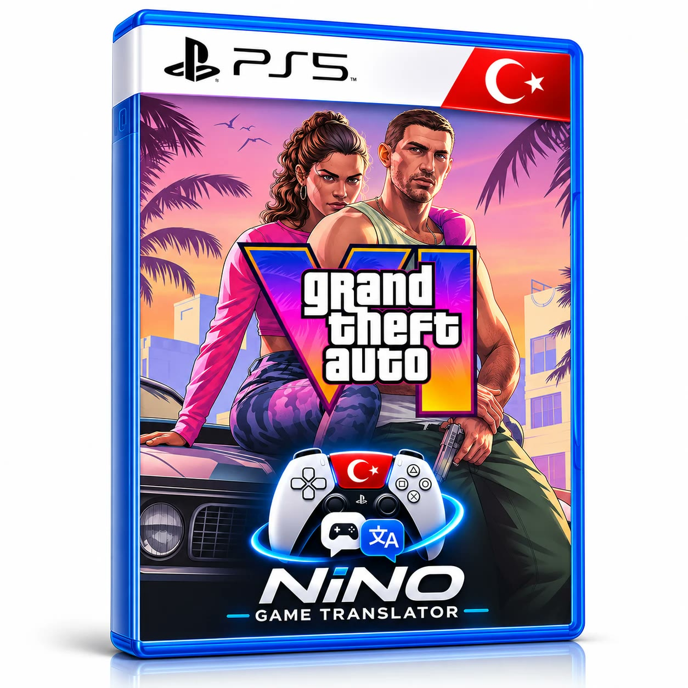</p>

<h1 align="center">Nino Game Translator</h1>

<p align="center"><b>Türkçe desteği olmayan PS5 ve Xbox oyunlarını Türkçe oynayın.</b><br>
Oyundaki İngilizce altyazıyı anlık olarak Türkçeye (ya da Arapçaya) çevirir ve TV'de, oyunun tam üstünde gösterir.<br>
Tamamen ücretsiz · açık kaynak · reklamsız · abonelik yok · hesap yok</p>

<p align="center">
  <a href="https://github.com/yunusdemirbag/nino-game-translator/releases/latest/download/Nino-Mac.zip"><b>⬇️ Mac</b></a> &nbsp;·&nbsp;
  <a href="https://github.com/yunusdemirbag/nino-game-translator/releases/latest/download/Nino-Windows-Setup.exe"><b>⬇️ Windows</b></a> &nbsp;·&nbsp;
  <b>📺 TV: Downloader'a <code>is.gd/ninoapk</code> yazın</b><br>
  <a href="https://github.com/yunusdemirbag/nino-game-translator/releases/latest/download/Nino-Telefon.apk">⬇️ Android telefon</a> &nbsp;·&nbsp;
  📱 iPhone: App Store incelemesinde &nbsp;·&nbsp;
  ▶️ Google Play: kapalı testte &nbsp;·&nbsp;
  <a href="docs/KURULUM.md"><b>📘 Kurulum Rehberi</b></a>
</p>

<p align="center">
  &nbsp;
  
</p>

---

## Nasıl çalışır

```
PS5 ──HDMI──▶ TV  ◀── Türkçe altyazı (TV'deki Nino uygulaması, oyunun üstünde)
 │                         ▲
 └─ Remote Play ──▶ Nino (Mac ya da Windows): okur → çevirir ─┘
    (ikinci, ücretsiz PSN hesabıyla)
```

Oyunu her zamanki gibi TV'de, kendi kolunuzla oynarsınız. Bilgisayardaki Nino aynı görüntüyü Remote Play ile alır,
altyazıyı okur, çevirir ve TV'ye gönderir. TV'deki Nino çeviriyi İngilizcenin tam üstüne koyar.

- **TV'de oynuyorsanız:** Önerilen kurulum **Mac ya da Windows + TV uygulaması**.
- **Capture Card'ınız varsa:** Mac ya da Windows görüntüyü karttan alır; Remote Play ve ikinci PSN hesabı gerekmez.
- **Xbox'ta oynuyorsanız:** Android telefon Xbox'ın ev yayınını Microsoft hesabınızla okur; Mac ve Windows Xbox penceresini okur. Ayrıntılar aşağıda, [Xbox](#xbox) bölümünde.
- **Bilgisayarınız yoksa ya da monitörde oynuyorsanız:** **Android telefon** (yakında iPhone) aynı işi yapar; altyazıyı TV'ye gönderir ya da kendi ekranında gösterir.

## 0.1.8'de yenilikler

- **🎮 Xbox desteği (deneysel):**
  - **Android telefon:** İlk açılışta "Hangi Konsolda Oynuyorsunuz?" diye sorar. Xbox'ı seçin, Microsoft hesabınızla giriş yapın (şifre yazmadan, microsoft.com/link'te kodla), Xbox'ınızı seçin ve kaydırın. İkinci hesap gerekmez.
  - **Mac ve Windows:** İlk ekranda **"Xbox'ta oynuyorum"**. Nino; Windows'ta Xbox uygulamasının **Uzaktan oynat** penceresini, Mac'te [Greenlight](https://github.com/unknownskl/greenlight) ya da **xbox.com/play** penceresini okur.
  - **Capture Card** yolu Xbox'ta da çalışır.
- Mac'in ilk ekranındaki kısa yollar (Remote Play penceresi, Xbox, Capture Card) artık hep görünüyor.
- Android'de gizlilik, yardım ve kaynak bağlantıları Nino'nun kendi sayfalarına yönlendirildi. [Gizlilik politikası](PRIVACY.md) Nino için yeniden yazıldı.

<details>
<summary><b>0.1.7'de yenilikler</b></summary>

**Mac ve Windows**
- **HDMI Capture Card:** PS5 görüntüsünü Capture Card'dan alma. Remote Play ve ikinci PSN hesabı gerekmez (Ayarlar › Bağlantı).
- **PS Remote Play penceresinden okuma** ve **Arapça çeviri**.
- Mac 0.1.5 ve sonrası güncellemeyi kendisi alır; Windows da kendini günceller.

**Android telefon (ve yakında iPhone)**
- **Yeni tasarım:** Sade ana ekran, canlı altyazıların aktığı koyu sahne kartı ve **"Başlatmak İçin Kaydırın"** çubuğu; kaydırınca tutamaç camlı bir **ay yıldız** (Arapça'da 🇸🇦) olur.
- **Yan çevirin, tam ekran açılsın;** ana ekran hep dikey kalır. Yenilenen kurulum ekranları ve **PS5'siz demo**.
- **Tam Arapça:** Çeviri dili Arapça seçilince menüler de Arapçaya döner; uygulama yalnız Türkçe ve Arapça açılır.
- **PS5 kendiliğinden bulunur**, Sony girişi düzeldi, bazı MediaTek telefonlarda görüntü okunamaması giderildi.
- **HDMI Capture Card (deneysel):** Android 14+ telefonlarda USB-C ile.

</details>

## Kimler kullanabilir

| Nino'yu çalıştıran cihaz | Durum |
|---|---|
| **Mac** (Apple Silicon: M1 ve sonrası) | ✅ Hazır, en çok denenen |
| **Windows 10/11** bilgisayar | ✅ Hazır |
| **Android telefon** (Android 8 ve üzeri) | ✅ Hazır, yeni tasarım |
| **iPhone** | 🔜 App Store incelemesinde |

| Altyazının çıktığı yer | Durum |
|---|---|
| **Android TV / Google TV** (TCL, Sony, Philips, Xiaomi, Hisense ve diğerleri) | ✅ Hazır, denendi |
| **LG** (webOS) · **Samsung** (Tizen) | 🧪 Deneysel |
| **Bilgisayar ya da telefon ekranı** (TV uygulaması olmadan, monitörde oynayanlar için) | ✅ Hazır |

## Gerekenler

| | |
|---|---|
| **Konsol** | PS5 (Remote Play açık) ya da Xbox Series X\|S (Uzak özellikler açık, deneysel) |
| **Bilgisayar** | Apple Silicon (M1 ve sonrası) Mac, macOS 13+ · ya da Windows 10/11 (64 bit). Bilgisayar yoksa Android 8+ telefon. |
| **TV** | Android TV / Google TV (denendi). LG ve Samsung deneysel. |
| **Hesap** | PS5: ikinci, ücretsiz bir PSN hesabı (Remote Play için; oyun sizin hesabınızda oynanır). Xbox: kendi Microsoft hesabınız. Capture Card ile hesap gerekmez. |
| **Ağ** | Konsol, bilgisayar/telefon ve TV aynı Wi-Fi'de |

## Kurulum

Adım adım anlatım: **[📘 Kurulum Rehberi](docs/KURULUM.md)**

**Mac:** [`Nino-Mac.zip`](https://github.com/yunusdemirbag/nino-game-translator/releases/latest/download/Nino-Mac.zip)'i indirin, Nino'yu **Uygulamalar**'a sürükleyin ve açın ("doğrulanamadı" derse **Sistem Ayarları › Gizlilik ve Güvenlik › Yine de Aç**). Nino adım adım yol gösterir: ikinci PSN hesabıyla giriş, PS5'i 8 haneli kodla eşleme, TV seçimi. TV'de USB hata ayıklama açıksa TV uygulamasını da Mac kurar.

**Windows:** [`Nino-Windows-Setup.exe`](https://github.com/yunusdemirbag/nino-game-translator/releases/latest/download/Nino-Windows-Setup.exe)'yi çalıştırın ("bilgisayarınızı korudu" derse **Ek bilgi › Yine de çalıştır**). Kurulum Mac ile aynıdır.

**TV (Android TV / Google TV):** Google Play'den **Downloader**'ı kurun, `is.gd/ninoapk` yazıp inen dosyayı kurun.

**Android telefon (bilgisayar yerine):** [`Nino-Telefon.apk`](https://github.com/yunusdemirbag/nino-game-translator/releases/latest/download/Nino-Telefon.apk)'yı telefonda indirip kurun, ikinci PSN hesabıyla **Sony İle Giriş Yapın**, PS5'teki 8 haneli kodu yazın ve oyunu açınca **kaydırın**.

**Xbox:** Telefonda ilk ekranda **Xbox**'ı seçip Microsoft hesabınızla giriş yapın; Mac ya da Windows'ta **"Xbox'ta oynuyorum"**a tıklayın. Adımlar: [Kurulum Rehberi › Xbox](docs/KURULUM.md#6-xbox-ile-kullanım-yeni-deneysel).

## Telefon uygulaması

<p align="center">
  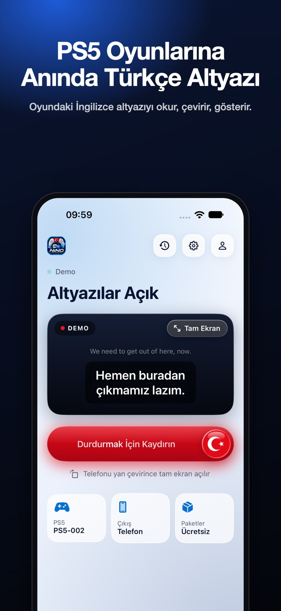&nbsp;
  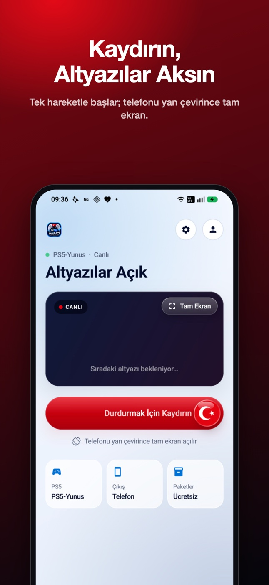&nbsp;
  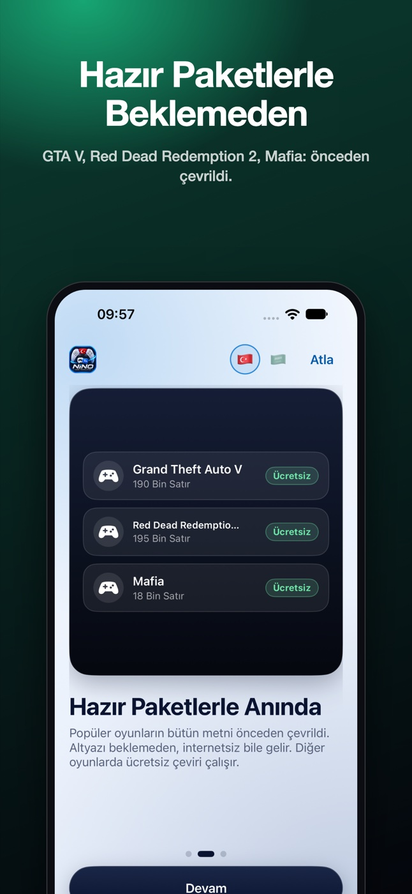&nbsp;
  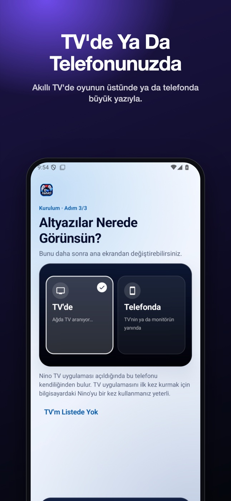
</p>

<p align="center">
  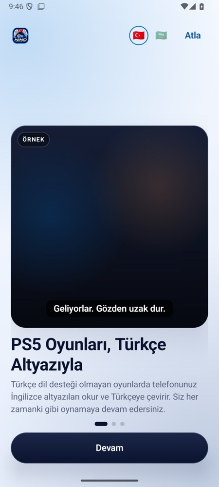&nbsp;
  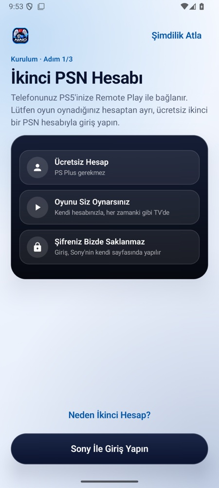&nbsp;
  &nbsp;
  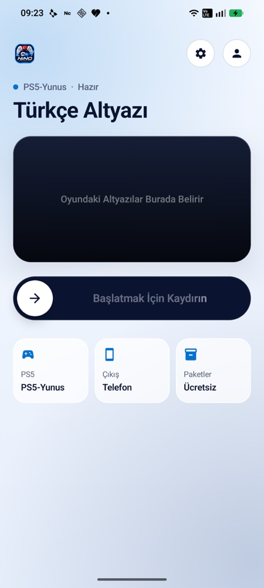&nbsp;
  
</p>

## Xbox

<p align="center">
  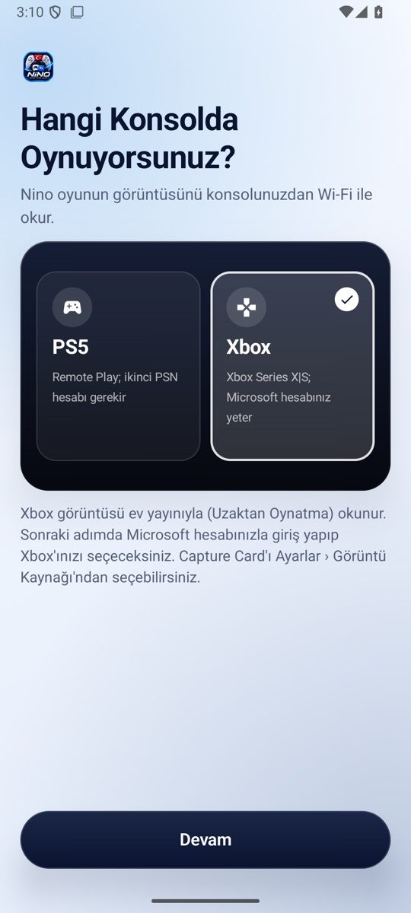&nbsp;
  &nbsp;
  
</p>
<p align="center">
  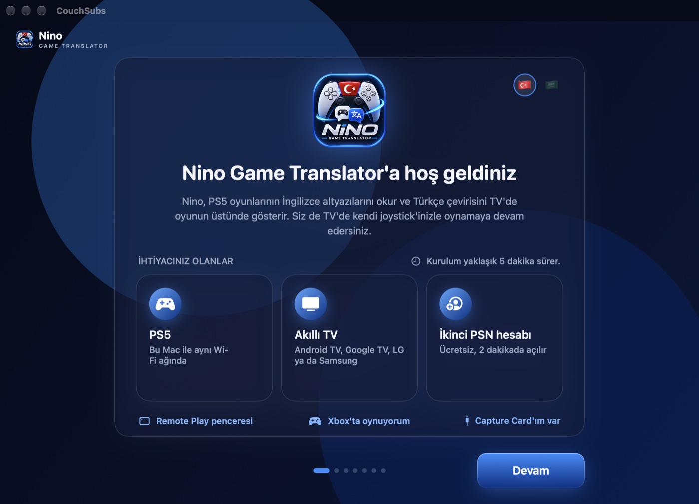
</p>

- **Android telefon:** Nino, Xbox uygulamasındaki "Uzaktan oynat" ile aynı ev yayınını Wi-Fi'dan **yalnız izler**: ses çalmaz, kolunuza ve hesabınıza dokunmaz. Microsoft girişi kodla yapılır, şifrenizi Nino görmez; oturum jetonu yalnız telefonda şifreli saklanır.
- **Mac ve Windows:** Xbox'ı bilgisayarda açtığınız pencereden (Windows'ta Xbox uygulaması, Mac'te Greenlight ya da xbox.com/play) okur.
- **Xbox'ta:** Ayarlar › Cihazlar ve bağlantılar › **Uzak özellikler** açık olmalı.
- Xbox desteği yeni: kod hazır ve testleri geçiyor ama gerçek Xbox'larla az denendi. Gördüğünüz sorunları [Issues](https://github.com/yunusdemirbag/nino-game-translator/issues)'a yazın.

## العربية · Arapça

<p align="center">
  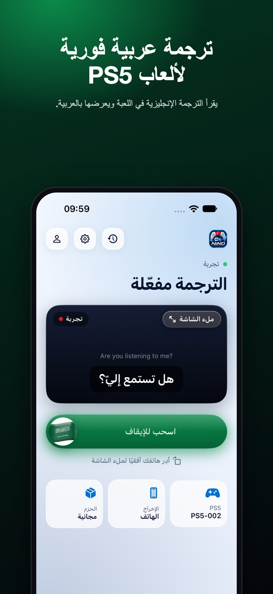&nbsp;
  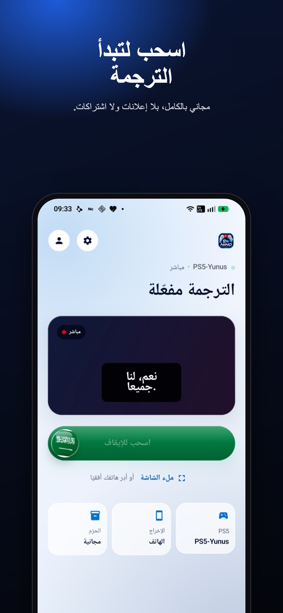&nbsp;
  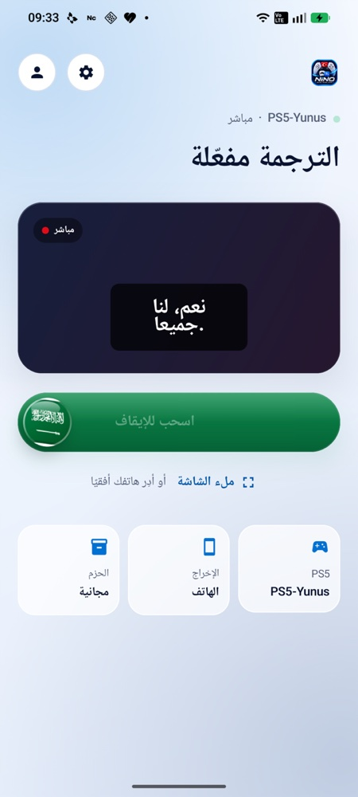
</p>

<p dir="rtl" align="right"><b>نينو</b> يقرأ الترجمة الإنجليزية في ألعاب PS5 ويعرضها مترجمة إلى العربية فورًا فوق اللعبة على التلفاز، عبر تطبيق Mac أو Windows أو الهاتف. اختر العلم السعودي لتختار الترجمة العربية. مجاني بالكامل، مفتوح المصدر، بلا إعلانات ولا اشتراكات.</p>

## Gizlilik

- Altyazı okuma (yazı tanıma) ve ücretsiz çeviri cihazınızda yapılır.
- Gemini, DeepL gibi bir çeviri hizmeti seçerseniz yalnızca altyazı metni, **sizin anahtarınızla** o hizmete gider.
- **Ortak havuz:** Hazır pakette bulunmayan İngilizce altyazı satırları (yalnız metin, adsız) yeni oyun paketleri hazırlamak için Nino'nun kendi havuzuna gönderilir. Ayarlar'dan kapatabilirsiniz; kapatınca bekleyen satırlar da silinir.
- Nino hesap açtırmaz, reklam göstermez, sizi izlemez. Ayrıntılar: [PRIVACY.md](PRIVACY.md).

## Sık sorulanlar

**PS5'im yok, önce görmek istiyorum.** Android telefonda ana ekrandaki **"PS5'siz Deneyin"**e dokunun; örnek altyazılarla uygulamayı gezebilirsiniz.

**Xbox'ta da ikinci hesap gerekiyor mu?** Hayır. Xbox'ta kendi Microsoft hesabınızla giriş yapmanız yeter.

**Neden ikinci bir PSN hesabı gerekiyor?** Remote Play, PS5'e bağlanmak için bir hesap ister. Kendi hesabınızla oyun oynarken aynı anda o hesapla Remote Play açılamaz; ikinci (ücretsiz) hesap bunu çözer.

**Ekranda sürekli "Uzaktan Oynama" bildirimi çıkıyor.** PS5'te **Ayarlar › Sistem › Uzaktan Oynama**'ya gidip en alttaki seçeneği kapatın.

**Altyazı İngilizcenin tam üstüne gelmiyor.** Nino ilk birkaç altyazıda oyunun altyazı yerini öğrenir. Sorun sürerse Ayarlar › Altyazı'dan yerleşimi değiştirin.

**Dublajda yanlış ses çıkıyor.** Oyunun ses ayarlarında konuşma sesini kısın ama tamamen kapatmayın; Nino kimin konuştuğunu o sesten anlar.

## Kaynak koddan derleme

Mac ve iPhone uygulamaları Swift/SwiftUI, Android uygulaması Kotlin/Jetpack Compose ile yazılmıştır; Remote Play bağlantısı için [chiaki-ng](https://github.com/streetpea/chiaki-ng)'nin kütüphanesi kullanılır.

```bash
git submodule update --init --recursive
./scripts/build-chiaki-macos.sh        # libchiaki (Remote Play)
cd mac && xcodegen generate && xcodebuild -scheme CouchSubs -configuration Release build
```

TV uygulaması: `tv-android` (Android TV), `tv-webos` (LG ve paylaşılan TV sayfası), `tv-tizen` (Samsung).
Windows uygulaması: `windows` (.NET/WPF). Android telefon uygulaması: `couchsubs-android`. Ayrıntılar CouchSubs'ın [orijinal README'sinde](docs/README-CouchSubs.md).

## Lisans ve teşekkür

Nino, **GNU AGPL-3.0** lisansıyla yayımlanan ücretsiz ve açık kaynak bir yazılımdır. Ayrıntılar: [LICENSE](LICENSE), [NOTICE](NOTICE).

**Nino © 2026 Yunus Demirbağ.** Based on [CouchSubs](https://github.com/yorulmazsinan/couchsubs) by Sinan Yorulmaz, modified by Yunus Demirbağ on 2026-11-16.

Nino şu projelerin üzerine kuruludur:
1. **[Chiaki](https://git.sr.ht/~thestr4ng3r/chiaki)** — Florian Märkl ve katkıda bulunanlar: açık kaynak PlayStation Remote Play istemcisi.
2. **[chiaki-ng](https://github.com/streetpea/chiaki-ng)** — Street Pea ve katkıda bulunanlar: Chiaki'nin bakımı süren devamı.
3. **[CouchSubs](https://github.com/yorulmazsinan/couchsubs)** — Sinan Yorulmaz: Nino'nun kodunun başladığı altyazı okuma ve çeviri uygulaması.
4. **Dublaj sesleri:** Kyutai'nin [pocket-tts](https://github.com/kyutai-labs/pocket-tts)'i ve [Pocket TTS Turkish](https://huggingface.co/wite-tech/pocket-tts-turkish) (wite-tech, CC BY 4.0). Sesler yapaydır, gerçek kişilere ait değildir.
5. **Ücretsiz, internetsiz çeviri:** Windows'ta Helsinki Üniversitesi'nin [OPUS-MT](https://github.com/Helsinki-NLP/Opus-MT) İngilizce→Türkçe modeli (CC BY 4.0); Mac ve iPhone'da Apple'ın, Android'de Google ML Kit'in cihaz içi çevirisi.
6. **Yazı tanıma:** Apple Vision (Mac, iPhone), Windows OCR ve Google ML Kit (Android).
7. **Bilgisayarda yapay zekâ ile çeviri (isteğe bağlı):** [Ollama](https://ollama.com), Google'ın [TranslateGemma](https://ollama.com/library/translategemma)'sı ve Xiaomi'nin [MiLMMT](https://huggingface.co/xiaomi-research/MiLMMT-46-4B-v1.0)'si.
8. **Çevrimiçi çeviri (isteğe bağlı, kendi anahtarınızla):** Google Gemini, DeepL, OpenAI, Claude.
9. **Xbox:** UnknownSKL'nin [Greenlight](https://github.com/unknownskl/greenlight)'ı ve [xal-node](https://github.com/unknownskl/xal-node)'u (MIT; akış onlardan öğrenildi, kod Kotlin'de yeniden yazıldı) ve Google'ın [WebRTC](https://webrtc.org)'si (BSD-3).
10. **Diğer açık kaynak parçalar:** FFmpeg, OpenSSL, curl, nanopb, Jerasure, GF-Complete, json-c, libevent, miniupnpc, ONNX Runtime, Velopack (Windows kurulumu ve güncelleme), SSH.NET ve Patrick Stel'in [tizen-sdb](https://github.com/PatrickSt1991/tizen-sdb)'si (LG ve Samsung TV kurulumu). Tam liste: [THIRD-PARTY-NOTICES.md](THIRD-PARTY-NOTICES.md).

Bu projelerin geliştiricilerine çok teşekkürler. Nino onların emeği olmadan olmazdı. 🙏

Geliştiren: **Yunus Demirbağ** · Destekleyenler: **M. Akif Demirbağ**

*Nino, Sony Interactive Entertainment ve Microsoft ile bağlantılı değildir. PlayStation ve PS5, Sony Interactive Entertainment Inc.'in; Xbox, Microsoft Corporation'ın ticari markalarıdır.*

---

### English

**Nino** translates the English subtitles of PS5 and Xbox games into Turkish (or Arabic) in real time and shows them on your TV, right on top of the game, or on your phone. An Android phone (or a Mac, a Windows PC, or an iPhone) watches the game through Remote Play (with a second, free PSN account), reads the subtitles, translates them and sends them to the Nino app on the TV. On Xbox (experimental) the Android app signs in with your Microsoft account and watches the Xbox home stream; Mac and Windows read the Xbox window. Free, open source (AGPL-3.0), no ads, no subscriptions. Based on CouchSubs by Sinan Yorulmaz.
