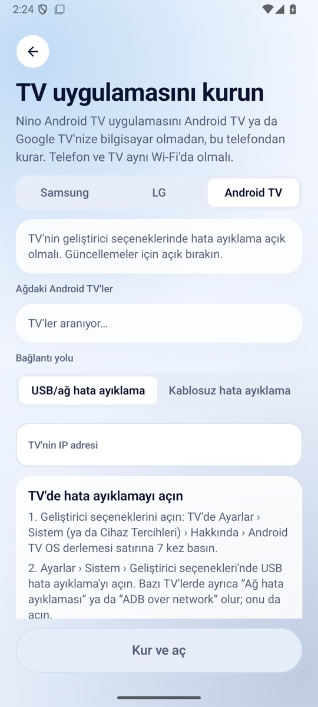
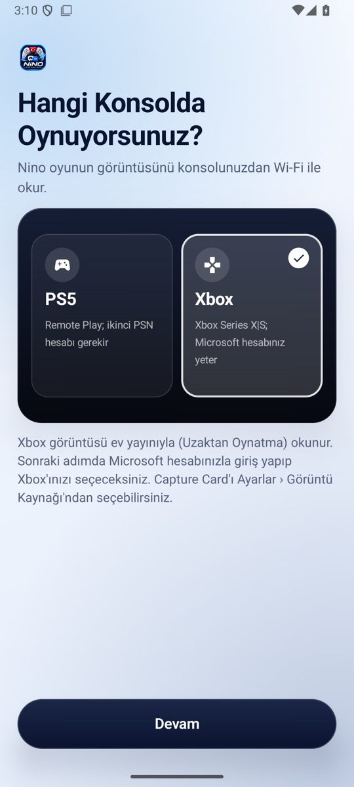
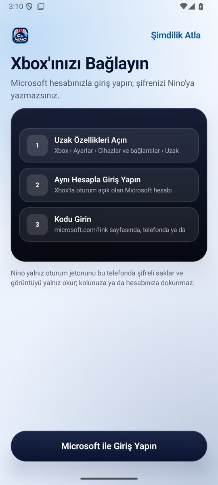
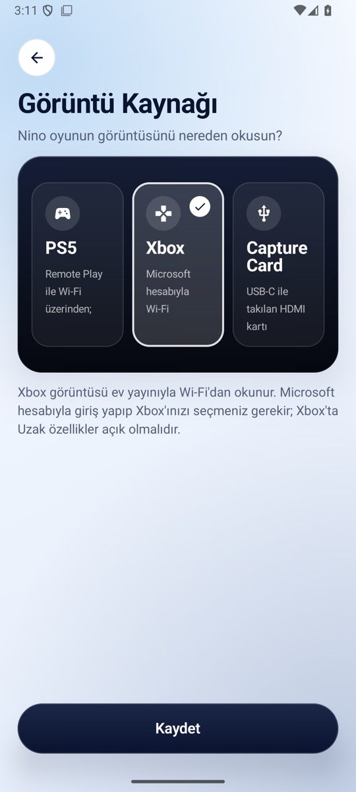
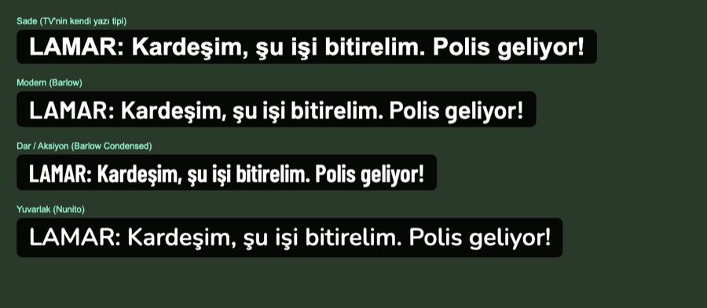

# Nino Kurulum Rehberi

Bu rehber, Nino'yu ilk kez kuracak herkes için hazırlanmıştır. Teknik bilgi gerekmez; adımları sırayla izlemeniz
yeterlidir. Kurulum yaklaşık **5–10 dakika** sürer.

> 🌍 **11 dil:** 🇹🇷 Türkçe · 🇸🇦 العربية · 🇮🇳 हिन्दी · 🇮🇩 Bahasa Indonesia · 🇹🇭 ไทย · 🇻🇳 Tiếng Việt · 🇵🇰 اردو · 🇧🇩 বাংলা ·
> 🇲🇾 Bahasa Melayu · 🇵🇭 Filipino · 🇳🇱 Nederlands. Karşılama ekranının sağ üstündeki bayraktan seçin; hem çeviri hem
> uygulamanın menüleri o dile geçer.

---

## 1. Önce hangi kurulumun size uygun olduğunu seçin

| Durumunuz | Önerilen kurulum | Neye ihtiyacınız var |
|---|---|---|
| PS5'iniz **akıllı TV'ye ya da akıllı monitöre** bağlı (Android TV / Google TV, Samsung, LG) | **Mac ya da Windows + TV** (önerilen) | Mac ya da Windows bilgisayar, TV'de Nino uygulaması, ikinci (ücretsiz) PSN hesabı |
| Bilgisayarınız yok ama TV'niz akıllı | **Telefon + TV** | Android telefon, TV'de Nino uygulaması, ikinci PSN hesabı |
| PS5'iniz **sıradan bir monitöre / eski TV'ye** bağlı | **Telefon ekranında altyazı** | Android telefon (ya da iPhone), ikinci PSN hesabı |
| Elinizde **HDMI Capture Card** var | **Mac/Windows + Capture Card** | Mac ya da Windows bilgisayar, Capture Card (Remote Play ve ikinci hesap gerekmez) |
| **Yayın** yapıyorsunuz (OBS, TikTok LIVE Studio) | **Windows + Capture Card + OBS** (bkz. Bölüm 7) | Kart OBS'e bağlı kalır, Nino altyazıyı OBS projektöründen okur |
| **Xbox Series X\|S**'te oynuyorsunuz | **Android telefon** (ya da Mac/Windows'ta Xbox penceresi) | Microsoft hesabınız; ikinci hesap gerekmez (bkz. Bölüm 6) |
| Sadece **denemek** istiyorsunuz | **Demo** | Yalnız telefon: "PS5'siz Deneyin" |

Hepsinde konsol (PS5 ya da Xbox), telefon/bilgisayar ve TV **aynı Wi-Fi ağında** olmalıdır.

---

## 2. Mac ve Windows ile kurulum (TV için önerilen)

> 📷 PS5 ve Android TV için adım adım fotoğraflı anlatım: **[Android TV Rehberi](KURULUM-ANDROID-TV.md)**

1. **[Nino-Mac.zip](https://github.com/yunusdemirbag/nino-game-translator/releases/latest/download/Nino-Mac.zip)**
   dosyasını indirin, açın ve **Nino**'yu **Uygulamalar** klasörüne sürükleyin.
2. Nino'yu açın. Mac "doğrulanamadı" derse: **Sistem Ayarları › Gizlilik ve Güvenlik › Yine de Aç**.
3. Nino sizi adım adım yönlendirir: ikinci PSN hesabıyla giriş → PS5'i 8 haneli kodla eşleme → TV seçimi.
4. **Capture Card'ınız varsa:** İlk açılışta ya da **Ayarlar › Bağlantı**'da görüntü kaynağı olarak **Capture Card**'ı
   seçin. Bu yolda Remote Play ve ikinci PSN hesabı gerekmez; kartı PS5 ile TV/monitör arasına bağlayın.
5. Mac uygulaması yeni sürümleri kendiliğinden indirip kurar.

**Windows:** **[Nino-Windows-Setup.exe](https://github.com/yunusdemirbag/nino-game-translator/releases/latest/download/Nino-Windows-Setup.exe)**
dosyasını çalıştırın ("bilgisayarınızı korudu" uyarısında **Ek bilgi › Yine de çalıştır**). Kurulum Mac ile aynıdır.

---

## 3. Android telefonla kurulum (bilgisayar yerine)

### 3.1 Uygulamayı yükleyin
1. Telefonda şu bağlantıyı açın:
   **[Nino-Telefon.apk](https://github.com/yunusdemirbag/nino-game-translator/releases/latest/download/Nino-Telefon.apk)**
2. İnen dosyaya dokunun. Telefon izin isterse **"Bu kaynaktan yüklemeye izin ver"** seçeneğini açın ve **Yükle**'ye basın.
3. Daha önce Nino kuruluysa yeni sürüm eskisinin üstüne kurulur; ayarlarınız korunur.

### 3.2 İlk açılış
1. **Karşılama:** Üç kısa sayfa Nino'yu tanıtır. Sağ üstteki bayraktan çeviri dilini seçin (11 dil; Türkçe en üstte).
2. **Konsol:** "Hangi Konsolda Oynuyorsunuz?" ekranında **PS5**'i seçin. (Xbox için Bölüm 6'ya bakın.)
3. **Adım 1 – İkinci PSN Hesabı:** **"Sony İle Giriş Yapın"**a dokunun ve oyun oynadığınız hesaptan **farklı**,
   ücretsiz bir PlayStation hesabıyla giriş yapın. Giriş Sony'nin kendi sayfasında yapılır; şifreniz Nino'ya gelmez.
   *(Neden ikinci hesap? PS5, oyun oynadığınız hesapla aynı anda Remote Play bağlantısı açmaya izin vermez.)*
4. **Adım 2 – PS5'inizi Eşleyin:** Nino PS5'inizi ağda kendiliğinden bulur.
   - PS5'te **ikinci hesapla** giriş yapın → **Ayarlar › Sistem › Uzaktan Oynama › Cihazı Eşleştir**.
   - Ekranda çıkan **8 haneli kodu** telefona yazın ve **Eşle**'ye basın.
   - PS5 görünmüyorsa: PS5'in açık ya da dinlenme modunda olduğundan emin olun; liste birkaç saniyede bir yenilenir.
5. **Adım 3 – Altyazılar Nerede Görünsün?**
   - **TV'de:** Akıllı TV'nizde Nino uygulaması varsa. Yoksa bu ekrandaki **"TV uygulamasını kurun"**a dokunun; telefon
     kurar (bkz. Bölüm 5).
   - **Telefonda:** TV uygulaması yoksa ya da PS5 bir monitöre bağlıysa. Telefonu ekranın yanına koymanız yeterli.

### 3.3 Kullanım
1. PS5'te oyununuzu kendi hesabınızla açın.
2. Nino'da **"Başlatmak İçin Kaydırın"** çubuğunu sona kadar kaydırın.
3. Altyazılar akmaya başlar. Telefonu **yan çevirirseniz** altyazı **tam ekran** açılır.
4. Durdurmak için çubuğu geri kaydırın.

> İpucu: Uzun oyunlarda telefonu şarja takın. Wi-Fi zayıfsa telefonu modeme yakın tutun.

---

## 4. iPhone

iPhone uygulaması App Store incelemesindedir. Yayınlanınca bağlantısı burada olacaktır. Kurulum adımları Android
ile aynıdır.

> **Google Play:** Android uygulaması Google Play'de kapalı testte. Herkese açılınca bağlantısı burada olacak; o zamana
> kadar APK ile kurun (Bölüm 3).

---

## 5. TV uygulamasını kurma

Altyazının TV'de, oyunun üstünde görünmesi için TV'ye bir kez **Nino TV** uygulaması kurulur. TV'nize göre en kolay yolu
seçin. Hepsinde TV, telefon/bilgisayar ve konsol **aynı Wi-Fi'da** olmalıdır.

| TV'niz | En kolay yol |
|---|---|
| **Android TV / Google TV** (TCL, iFFALCON, Sony, Philips, Xiaomi, Hisense, Vestel, Arçelik…) | Telefondan (5.1) ya da bilgisayardan (5.2); olmazsa TV'nin tarayıcısıyla elle (5.3) |
| **Samsung** TV ya da Samsung **akıllı monitör** (M serisi; 2016 ve sonrası) | Telefondan (5.1) ya da bilgisayardan (5.2) |
| **LG** TV (webOS) | Telefondan (5.1) ya da bilgisayardan (5.2) — deneysel |

### 5.1 Telefondan kurulum (bilgisayar gerekmez)

1. Android telefondaki Nino'da **Profil › Nino'yu TV'ye Kur**'a dokunun (ya da kurulumdaki "Altyazılar Nerede Görünsün?"
   ekranında **TV uygulamasını kurun**). Telefon ağdaki TV'leri arar; markanızı seçin.
2. Ekrandaki adımları izleyin. Her marka için TV'de **bir kez** yapılan ayar şudur:

**Android TV / Google TV**
1. TV'de **Ayarlar › Sistem › Hakkında**'ya gidin, **Android TV işletim sistemi yapısı** satırına art arda **7 kez** basın.
   "Artık geliştiricisiniz" yazar.
2. **Ayarlar › Sistem › Geliştirici seçenekleri**'nde **USB hata ayıklama**'yı açın (varsa **Kablosuz hata ayıklama**'yı da).
3. Telefonda **Kur ve aç**'a basın. TV'de **"USB hata ayıklamasına izin verilsin mi?"** sorusu çıkar:
   **"Bu cihazdan her zaman izin ver"**i işaretleyip **İzin ver**'e basın.
4. Nino TV'de açılır. Güncellemeler için hata ayıklamayı açık bırakın.

**Samsung TV / akıllı monitör**
1. TV'de **Uygulamalar** ekranını açın, kumandada **1 2 3 4 5**'e basın. **Geliştirici modu** penceresi açılır.
2. **Developer mode**'u **On** yapın; **Host PC IP** alanına telefonda gösterilen adresi yazın ve **OK**'e basın.
3. TV'yi **yeniden başlatın**: güç tuşunu TV kapanana kadar ~2 saniye basılı tutun, sonra açın (kısa basmak yetmez).
4. Telefonda **Kur ve aç**'a basın. İlk kurulumda bir kez **ücretsiz Samsung hesabıyla** giriş istenir.

**LG TV (deneysel)**
1. webostv.developer.lge.com'da ücretsiz **LG geliştirici hesabı** açın.
2. TV'de LG Content Store'dan **Developer Mode** uygulamasını kurun, hesabınızla girin, **Dev Mode Status**'u açın.
3. Uygulamayı yeniden açıp **Key Server**'ı açın; sol altta 6 karakterli **Passphrase** görünür. Bunu telefona yazıp
   **Kur ve aç**'a basın.
4. Geliştirici modu en çok 1000 saat açık kalır; süre dolmadan Developer Mode uygulamasında **EXTEND**'e basın.

### 5.2 Bilgisayardan kurulum

Mac ya da Windows'taki Nino, kurulumun TV adımında TV'nizi bulur ve uygulamayı kendisi kurar. TV'deki ayar 5.1'deki
ile aynıdır (Android TV'de hata ayıklama, Samsung'da geliştirici modu, LG'de Developer Mode).

### 5.3 Elle kurulum: TV'nin tarayıcısıyla (yalnız Android TV / Google TV)

TV'nin tarayıcısında en üstteki **adres (URL) çubuğuna** `https://is.gd/ninotvapk` yazmanız yeter; inen dosyayı açıp kurun.
TV'nizin tarayıcısı dosya indirmiyorsa ücretsiz **Downloader** uygulamasıyla şöyle yapın:

1. TV'de **Google Play**'den ücretsiz **Downloader** uygulamasını kurun ve açın.
2. Downloader'a izin verin: **Ayarlar › Uygulamalar › Güvenlik ve kısıtlamalar › Bilinmeyen kaynaklar › Downloader**'ı
   açın (bazı TV'lerde Downloader ilk açılışta bunu kendisi sorar).
3. Downloader'ın soldaki menüsünden **Ana Sayfa**'yı (Home) seçin. Ortadaki adres kutusuna tam olarak şunu yazın ve
   **Git**'e basın:
   **`https://is.gd/ninotvapk`**
   ⚠️ **Tarayıcı** sekmesine yazmayın; oraya yazınca Google'da arar. Olmazsa tam adres:
   `https://yunusdemirbag.github.io/nino-game-translator/tv.apk`
4. Dosya iner ve kurulum penceresi açılır: **Yükle**'ye, sonra **Aç**'a basın.
5. Bazı TV'lerde (ör. TCL): **Ayarlar › Uygulamalar › Özel uygulama erişimi › Diğer uygulamaların üzerinde göster ›
   Nino** iznini açın. (Telefondan ya da bilgisayardan kurulumda bu izni Nino kendisi verir.)

TV'de Nino'yu açtığınızda TV, konsolun bağlı olduğu HDMI girişini gösterir ve altyazıyı oyunun üstüne yazar.

---

## 6. Xbox ile kullanım (yeni, deneysel)

> Xbox desteği 0.1.8'de geldi. Kod hazır ve testleri geçiyor ama gerçek bir Xbox ile henüz az denendi. Sorun görürseniz
> [GitHub › Issues](https://github.com/yunusdemirbag/nino-game-translator/issues)'a yazın.

  &nbsp;
  &nbsp;
  

### 6.1 Android telefonla (önerilen)
1. **Xbox'ta:** **Ayarlar › Cihazlar ve bağlantılar › Uzak özellikler**'i açın. Güç modu "Uyku" olmalı ki Nino Xbox'ı
   uzaktan bulabilsin.
2. **Telefonda:** Nino'yu açın, **"Hangi Konsolda Oynuyorsunuz?"** ekranında **Xbox**'ı seçin.
   (Daha önce kurduysanız: **Ayarlar › Görüntü Kaynağı › Xbox**.)
3. **Microsoft ile Giriş Yapın**'a dokunun. Nino bir kod gösterir; **Kodu Kopyala ve Sayfayı Aç** ile
   microsoft.com/link sayfasında kodu girin. Xbox'ta oturum açık olan **aynı hesabı** kullanın. Şifrenizi Nino'ya yazmazsınız.
4. Listeden Xbox'ınızı seçin. Oyunu açıp çubuğu **kaydırın**; altyazılar telefonda ya da TV'de akar.

PS5'tekinin aksine **ikinci hesap gerekmez**: Nino, Xbox uygulamasındaki "Uzaktan oynat" ile aynı ev yayınını yalnız
izler. Ses çalmaz, kolunuza ya da hesabınıza dokunmaz.

### 6.2 Mac ya da Windows ile (Xbox penceresi)
1. Xbox'ı bilgisayarda açın: **Windows**'ta Microsoft'un **Xbox** uygulamasındaki **Uzaktan oynat**, **Mac**'te ücretsiz
   [Greenlight](https://github.com/unknownskl/greenlight) ya da tarayıcıda **xbox.com/play**.
2. Nino'nun ilk ekranında **"Xbox'ta oynuyorum"**u seçin. PS5 adımları atlanır; Nino o pencereyi okur ve çeviriyi TV'ye
   ya da bilgisayar ekranına gönderir.

### 6.3 Capture Card ile
Capture Card yolu konsoldan bağımsızdır: Xbox'ı kartın HDMI girişine bağlayın, gerisi PS5 ile aynı (Bölüm 2 ve
Ayarlar › Görüntü Kaynağı › Capture Card). Xbox oyunlarda genellikle HDCP kullanmaz.

---

## 7. Yayıncılar için: OBS ile (Windows)

Capture card ile yayın yapıyorsanız görüntüyü ve sesi Nino'dan geçirmeyin; kart OBS'te kalsın:
1. Kartı OBS'e **Video Yakalama Aygıtı** olarak ekleyin (ses de buradan gelir).
2. OBS'te kartın kaynağına sağ tıklayıp **Pencereli Projektör (Kaynak)**'u açın.
3. Nino'da **Ayarlar › Görüntü kaynağı › OBS projektörü veya oyun penceresi**'ni seçin, listeden projektör penceresini
   seçin.
4. Nino'da **Ayarlar › OBS katmanı**'ndaki adresi kopyalayın; OBS'e **Tarayıcı** kaynağı olarak ekleyin (1920×1080).
   Altyazı yayına **tek** gelir.

---

## 8. Altyazının görünüşü

**Ayarlar › Altyazı görünümü**'nden yazı boyu, rengi, arka plan koyuluğu ve **yazı tipi** seçilir: **Aksiyon (GTA
tarzı, varsayılan)**, Modern, Yuvarlak ya da Sade. Arka planı %0 yaparsanız kutu kalkar, yazının etrafında ince kontur
kalır (oyunun İngilizce altyazısı da alttan görünür).

---

## 9. Sık karşılaşılan durumlar

| Durum | Çözüm |
|---|---|
| PS5 bulunamıyor | PS5 açık ya da dinlenme modunda olmalı; telefon ve PS5 aynı Wi-Fi'de olmalı. "Yeniden Ara"ya dokunun. |
| Sony giriş sayfası açılmıyor | "Tarayıcıda giriş yap" seçeneğini kullanın. |
| Altyazı görünmüyor | Oyunun kendi altyazısının **açık** olduğundan emin olun (Nino İngilizce altyazıyı okur). |
| "Uzaktan Oynama" bildirimi sürekli çıkıyor | PS5'te ikinci hesapla **Ayarlar › Sistem › Uzaktan Oynama**'da en alttaki **Uzaktan Oynama Bağlantı Durumunu Gizle**'yi açın. |
| Telefon ısınıyor | Telefonu şarjda ve serin bir yerde tutun; ekran parlaklığı tam ekranda kendiliğinden azalır. |
| Xbox listede görünmüyor | Xbox'ta Uzak özellikler açık mı, aynı Microsoft hesabıyla mı giriş yaptınız? Güç modunu "Uyku" yapın. |
| Sadece görmek istiyorum | Ana ekranda **"PS5'siz Deneyin"**e dokunun; örnek altyazılarla uygulamayı gezebilirsiniz. |
| Downloader indirmiyor, Google açılıyor | Adresi **Tarayıcı** sekmesine yazmışsınız. Soldan **Ana Sayfa**'yı seçip `https://is.gd/ninotvapk` yazın. |
| TV "USB hata ayıklama" sorusunu göstermiyor | Geliştirici seçeneklerinde hata ayıklamanın açık olduğundan emin olun; TV'yi kapatıp açın ve tekrar deneyin. |
| Samsung TV telefonu kabul etmiyor | Geliştirici modu penceresindeki **Host PC IP** telefonun adresi mi? Değiştirdikten sonra TV'yi güç tuşunu basılı tutarak yeniden başlatın. |
| OBS'te iki altyazı çıkıyor | Nino penceresini değil, kartın kendisini OBS'e ekleyin ve Bölüm 7'deki yolu izleyin. |

---

Nino ücretsizdir, reklam göstermez, hesap açtırmaz. Takıldığınızda uygulamada Ayarlar'daki **Sorun Bildir**'den
açıklama ve ekran görüntüsüyle bize yazın; ya da [GitHub › Issues](https://github.com/yunusdemirbag/nino-game-translator/issues).
